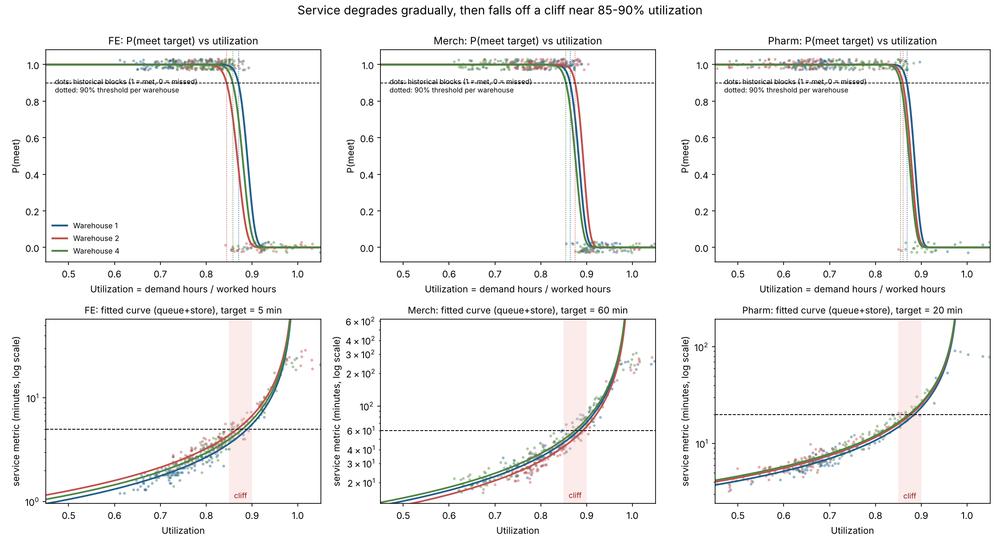
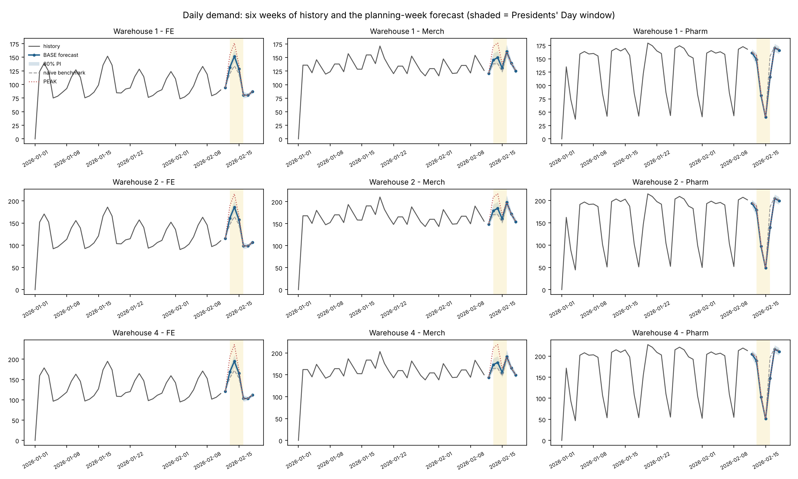

# MISA Costco case, Phase 1 report

All numbers below are produced by `run_all.py` from the files in `team_distribution/csv` and are written to `outputs/`. Source files are cited as `docs/...`, `sql/...` or `csv/...`.

## 0. Inventory and validation

### Files received

| file | rows | n_cols |
|---|---|---|
| DATA_DICTIONARY.csv | 91 | 5 |
| PlanningWeek_BenchmarkForecast.csv | 63 | 12 |
| TEAM_SUBMISSION_TEMPLATE.csv | 567 | 13 |
| comp_DimShift.csv | 3 | 3 |
| comp_FactShiftAvailability.csv | 1701 | 12 |
| comp_FactShiftDemand.csv | 1134 | 9 |
| comp_FactShiftSchedule.csv | 1323 | 17 |
| comp_FactShiftServiceLevel.csv | 1134 | 9 |
| comp_LaborCostAssumption.csv | 9 | 12 |
| comp_LaborStandard.csv | 3 | 5 |
| comp_Scenario.csv | 4 | 8 |
| comp_ScenarioDemandAdjustment.csv | 567 | 8 |
| comp_ServiceMetricDefinition.csv | 3 | 8 |
| comp_ShiftDefinition.csv | 27 | 10 |
| v_PlanningWeekGrid.csv | 567 | 37 |
| v_ShiftHistory.csv | 1134 | 45 |

Plus (not loaded as tables): `Costco_Workforce_Case_Student_DataPack.xlsx` (same tables as the CSVs), `README.md`, `docs/ASSUMPTIONS.md`, `docs/DATA_DICTIONARY.md`, `sql/01..06`, and the case PDF (8 pages, no scoring rubric beyond `service first, then labor cost, then feasibility`).

### What the docs and SQL define (used verbatim)

- Grain of every fact table: warehouse (1, 2, 4) x department (38, 92, 95) x date x shift (OPEN, MID, EVE) (`docs/DATA_DICTIONARY.md`).
- Shift lengths (paid hours per head) and min_staff come from `comp.ShiftDefinition` (`sql/04`, lines 178-206): FE 4/4/4 h weekday, 4/3.5/2.5 Sat, 4/3/2.5 Sun; Merch 6/5/6, 5.5/4.5/4.5, 5/4/4.5; Pharmacy 3.5/3/3.5 weekday, 4/5/closed Sat, closed/5/closed Sun. min_staff: FE 4/6/5 (Sat 5/6/4, Sun 4/6/4), Merch 6/3/4 (Sat 6/3/3, Sun 5/3/3), Pharmacy 2. Note `docs/ASSUMPTIONS.md` summarises min_staff as ranges (4-6, 3-6, 2); the table in `sql/04` and `csv/comp_ShiftDefinition.csv` is the binding source.
- Capacity of a block = available_regular + usable cross-trained flex + max_overtime (`README.md`, `sql/05` check S06/S07). Flex is FE<->Merch only, limited to people the partner department is not using in that shift (`docs/ASSUMPTIONS.md` s.4-5).
- Costing rule (`docs/ASSUMPTIONS.md` s.5, `sql/06` Q5): fill regular first, then flex, then OT; block cost = (regular + flex) x paid hours x loaded regular rate + OT x paid hours x loaded OT rate. Loaded OT / loaded regular = 1.32 for every warehouse x dept (check K04).
- Service: one metric per dept, meets target when metric_value <= target (5 / 60 / 20 min); simulated from demand relative to WORKED hours (`docs/DATA_DICTIONARY.md` FactShiftSchedule.worked_employees: 'drives the service outcome'; `docs/ASSUMPTIONS.md` s.6).
- Judging order: service, then labor cost, then feasibility (`README.md`).
- Benchmark: `src.FactDailyPrediction` model_run_id 2026021101 = mean of the same weekday in weeks 3-6, no holiday/promo/weather logic (`sql/04` lines 139-169). Confirmed: 63 rows with that id.
- Closed blocks: Pharmacy Sat EVE, Sun OPEN, Sun EVE (licensure/hours assumption in `comp.ShiftDefinition`) = 9 blocks per scenario in the planning week; in history also all 27 blocks of New Year's Day (warehouse closed). Closed = 0 demand, 0 staff, no service value (check D04).
- 567 template rows = 3 scenarios x 189 blocks; keys match `v_PlanningWeekGrid` exactly (checks C10-C12). Shift demand sums to daily demand on every day (D01).

### Checks: 44 PASS, 16 INFO, 0 FAIL (`outputs/00_validation_checks.csv`)

Oddities found (nothing was changed in the data):

1. **50 open blocks have worked-hours utilization above 1.0** (max 1.774, Pharmacy W1 Feb 11 EVE); all 50 missed target. This is demand hours exceeding worked hours, i.e. genuine under-staffing, so they are kept. The service model is fitted on u <= 0.97 and treats anything above as a miss: 0 of the 114 blocks above u = 0.93 met target, and the highest utilization at which any block met target was 0.904. (`outputs/00_oddities.csv`)
2. **2 blocks where worked heads fell below min_staff after callouts** although the schedule met it; kept as-is, they are informative about callout risk.
3. **12 draft-schedule blocks exceed DISRUPT capacity** (intended by the organisers, check S07); the draft is identical across the three scenarios (S10).
4. **has_promotion is a deterministic calendar flag**: 1 on every Fri/Sat/Sun and every holiday-window day, 0 otherwise (W04). It carries no information beyond weekday and holiday role, so a separate promotion effect cannot be estimated from history.
5. **The daily demand history is generated by a closed-form formula** in `sql/02_Load_Core_Data.sql` (lines 445-525): transaction_count_proxy = weekly_sales x base_daily_weight(dept, weekday) x holiday_adjustment_factor(dept, window role) / base_ticket. We reproduced all 378 daily values from that formula to within 0.0002 (rounding). Consequence: the only randomness in demand is (a) the weekly sales level and (b) the split of a day into shifts (`sql/04`, literal values). Temperature, promotion index, fuel price, CPI and markdowns never enter the demand formula. We did not use the formula to forecast; the forecast model below is estimated from the data, and this finding tells us what its error budget is.
6. Missing values are only where the dictionary says so (closed blocks, availability_note, Draft callout fields). No duplicate keys, no negative or zero demand on open blocks.

## 1. Service-response model

Utilization u = shift demand x labor standard / worked labor hours (standards 1.50 / 1.20 / 0.165 h per unit, `csv/comp_LaborStandard.csv`). Worked hours explain service better than scheduled hours by 30-37% (log-RMSE of a simple exponential fit):

| dept | utilization_basis | rmse_log |
|---|---|---|
| FE | utilization | 0.182 |
| FE | sched_utilization | 0.278 |
| Merch | utilization | 0.224 |
| Merch | sched_utilization | 0.318 |
| Pharm | utilization | 0.181 |
| Pharm | sched_utilization | 0.287 |

### Candidate forms and leave-one-week-out CV (6 folds, fitted on open blocks with u <= 0.97)

Metrics: RMSE of log(metric), MAE in minutes, Brier score and log-loss of the implied P(meet). The model is chosen on out-of-sample log-loss of P(meet), the quantity we act on.

| dept | model | rmse_log | mae_minutes | brier_pmeet | logloss_pmeet | n | chosen |
|---|---|---|---|---|---|---|---|
| FE | queue | 0.1522 | 0.4736 | 0.0342 | 0.1044 | 342 |  |
| FE | queue+store | 0.1318 | 0.4079 | 0.0318 | 0.0996 | 342 | <- chosen |
| FE | exp | 0.1853 | 0.6034 | 0.0374 | 0.1249 | 342 |  |
| FE | exp+store | 0.1790 | 0.5845 | 0.0356 | 0.1201 | 342 |  |
| FE | exp+store_slope | 0.1736 | 0.5578 | 0.0376 | 0.1252 | 342 |  |
| FE | isotonic | 0.1489 | 0.4604 | 0.0358 | 0.1113 | 342 |  |
| Merch | queue | 0.1408 | 5.6021 | 0.0293 | 0.0963 | 337 |  |
| Merch | queue+store | 0.1259 | 5.0286 | 0.0246 | 0.0825 | 337 | <- chosen |
| Merch | exp | 0.2335 | 10.4354 | 0.0478 | 0.1633 | 337 |  |
| Merch | exp+store | 0.2039 | 9.2991 | 0.0456 | 0.1452 | 337 |  |
| Merch | exp+store_slope | 0.1971 | 8.9295 | 0.0450 | 0.1414 | 337 |  |
| Merch | isotonic | 0.1495 | 5.9891 | 0.0332 | 0.1091 | 337 |  |
| Pharm | queue | 0.1341 | 1.1935 | 0.0183 | 0.0599 | 301 |  |
| Pharm | queue+store | 0.1270 | 1.0877 | 0.0176 | 0.0590 | 301 | <- chosen |
| Pharm | exp | 0.1852 | 1.5552 | 0.0241 | 0.0770 | 301 |  |
| Pharm | exp+store | 0.1800 | 1.5129 | 0.0221 | 0.0728 | 301 |  |
| Pharm | exp+store_slope | 0.1665 | 1.3612 | 0.0226 | 0.0882 | 301 |  |
| Pharm | isotonic | 0.1281 | 1.0705 | 0.0192 | 0.0729 | 301 |  |

`queue+store` = log m = log( b / (1 - u/c) ) + warehouse intercept (a was pushed to 0 by the fit in all three departments). It beats the exponential form by 15-49% on every metric and the isotonic (non-parametric) curve by 1-24%, in every department, so the choice is not by eye.

### Chosen curves (plain words)

- **FE**: metric = 0.522 / (1 - u/0.993) minutes at warehouse 1; warehouse 2 x 1.211, warehouse 4 x 1.101. Residual sd on the log scale = 0.130 at u = 0.8 (slope of sd in u: +0.063 per unit u; corr(|resid|, u) = +0.047). Target 5 min; fitted on 342 blocks.
- **Merch**: metric = 6.732 / (1 - u/0.994) minutes at warehouse 1; warehouse 2 x 0.915, warehouse 4 x 1.069. Residual sd on the log scale = 0.123 at u = 0.8 (slope of sd in u: -0.018 per unit u; corr(|resid|, u) = -0.016). Target 60 min; fitted on 337 blocks.
- **Pharm**: metric = 2.020 / (1 - u/0.984) minutes at warehouse 1; warehouse 2 x 1.077, warehouse 4 x 1.119. Residual sd on the log scale = 0.121 at u = 0.8 (slope of sd in u: -0.020 per unit u; corr(|resid|, u) = -0.023). Target 20 min; fitted on 301 blocks.

In minutes the spread grows with utilization (sd rises from 0.2 min to 2.4 min for FE between u = 0.65 and 0.90), but on the log scale it is flat: the noise is multiplicative, about 12-13% of the mean, in every department. So P(meet | u) = Phi( (log target - log m(u)) / sigma ). (`outputs/01_service_sigma.csv`)

### Utilization at which P(meet) drops below 95% / 90% / 80% (bootstrap 90% band, 400 resamples)

| dept | warehouse | u at P=80% | u at P=90% | u at P=95% | 90% band (P=90%) |
|---|---|---|---|---|---|
| FE | 1 | 0.877 | 0.870 | 0.864 | 0.866-0.874 |
| FE | 2 | 0.853 | 0.844 | 0.837 | 0.841-0.848 |
| FE | 4 | 0.865 | 0.858 | 0.851 | 0.855-0.861 |
| Merch | 1 | 0.871 | 0.864 | 0.858 | 0.860-0.867 |
| Merch | 2 | 0.881 | 0.875 | 0.869 | 0.872-0.878 |
| Merch | 4 | 0.862 | 0.855 | 0.848 | 0.851-0.858 |
| Pharm | 1 | 0.874 | 0.869 | 0.863 | 0.862-0.873 |
| Pharm | 2 | 0.866 | 0.860 | 0.854 | 0.854-0.865 |
| Pharm | 4 | 0.861 | 0.855 | 0.849 | 0.851-0.858 |

Reading: every department falls off the cliff between u = 0.84 and 0.88. Warehouse 2's front end breaks earliest (0.844 for 90%); its merchandising holds longest (0.875). The bands are tight because the simulator is clean (300+ blocks per department); they measure sampling error of the fit, not whether the real world behaves like the simulator.

### Calibration of P(meet) on history

| pbin | n | predicted | observed |
|---|---|---|---|
| (-0.01, 0.05] | 176 | 0.002 | 0.000 |
| (0.05, 0.2] | 22 | 0.115 | 0.136 |
| (0.2, 0.5] | 27 | 0.331 | 0.333 |
| (0.5, 0.8] | 37 | 0.686 | 0.703 |
| (0.8, 0.95] | 46 | 0.895 | 0.870 |
| (0.95, 1.0] | 745 | 0.998 | 0.996 |

Overall: predicted hit rate 0.781 vs observed 0.779; by warehouse x dept the gap is at most 0.02 (`outputs/01_service_blocks.csv`).

### Endogeneity check (do managers' anticipations bias the curve?)

Managers schedule ahead of time, so they cannot react to the same block's realised service; the risk is that blocks they expected to be hard were staffed differently in ways correlated with the outcome. Callouts are a quasi-random shock to worked hours, so if the curve is causal, blocks hit by callouts must sit on the same curve as blocks that were not:

| dept | had_callout | n | mean_log_resid | sd | mean_u | diff_mean_log_resid | t_stat | corr_resid_schedUtil_given_u |
|---|---|---|---|---|---|---|---|---|
| FE | 0 | 118 | -0.013 | 0.129 | 0.775 | 0.020 | 1.364 | -0.029 |
| FE | 1 | 224 | 0.007 | 0.131 | 0.812 | 0.020 | 1.364 | -0.029 |
| Merch | 0 | 194 | 0.002 | 0.130 | 0.810 | -0.004 | -0.268 | -0.042 |
| Merch | 1 | 143 | -0.002 | 0.118 | 0.818 | -0.004 | -0.268 | -0.042 |
| Pharm | 0 | 263 | -0.003 | 0.117 | 0.703 | 0.026 | 0.969 | -0.122 |
| Pharm | 1 | 38 | 0.023 | 0.162 | 0.738 | 0.026 | 0.969 | -0.122 |

Residual differences are 0.02 log or less (t between -0.3 and 1.4) and the residual is uncorrelated with how far scheduled hours differed from worked hours. Conclusion: no detectable anticipation bias; the concern is small here. The remaining limitation is coverage: the curve is estimated where data exist (u 0.4-1.0), which covers the whole decision range.

## 2. Diagnosis: where the six weeks of labor went

For each open block we computed n90 = the smallest head count (>= min_staff) with P(meet) >= 90% at the block's actual demand, and compared worked heads (what served demand) and scheduled heads (what the manager planned) with it (`outputs/02_block_classification.csv`).

**Headline: 6.8% of labor dollars ($128,979 of $1,890,242 over six weeks) were spent in blocks staffed above the 90% service line, while 228 of the 233 missed-target blocks were under-staffed against that same line. Filling every starved block to n90 would have cost $71,099; the surplus covers it with $57,880 to spare, and 87% of the deficit sits in the same warehouse and labor pool (FE+Merch, or Pharmacy) as a surplus, so most of the fix is a reallocation rather than new spend. Expected hit rate at n90 everywhere: 97% vs 78% actual.**

Block counts (worked basis): 437 over-staffed, 331 right-sized, 285 under-staffed of 1053 open blocks; on the scheduled basis 526 over / 208 under. Average surplus in an over-staffed block: 1.9 heads; average deficit in an under-staffed block: 1.9 heads. Every deficit could have been filled from that block's own regular + OT availability (0 unfillable heads).

### By warehouse x department (six weeks)

| store_id | dept | labor_cost | over_blocks | right_blocks | under_blocks | surplus_cost | deficit_cost | net_cost_of_fix | missed | missed_understaffed | pct_met |
|---|---|---|---|---|---|---|---|---|---|---|---|
| 1 | FE | 238,057 | 92 | 16 | 15 | 25,598 | 2,214 | -23,385 | 12 | 11 | 90% |
| 1 | Merch | 233,583 | 23 | 38 | 62 | 4,790 | 13,885 | 9,095 | 49 | 48 | 60% |
| 1 | Pharm | 65,894 | 22 | 73 | 10 | 4,289 | 2,232 | -2,057 | 8 | 8 | 92% |
| 2 | FE | 270,553 | 37 | 31 | 55 | 7,258 | 17,818 | 10,561 | 48 | 47 | 61% |
| 2 | Merch | 311,509 | 62 | 30 | 31 | 15,786 | 7,694 | -8,092 | 22 | 22 | 82% |
| 2 | Pharm | 90,729 | 79 | 26 | 0 | 18,442 | 0 | -18,442 | 2 | 0 | 98% |
| 4 | FE | 288,534 | 54 | 38 | 31 | 13,166 | 7,784 | -5,381 | 25 | 25 | 80% |
| 4 | Merch | 319,992 | 61 | 17 | 45 | 38,503 | 11,749 | -26,754 | 40 | 40 | 67% |
| 4 | Pharm | 71,392 | 7 | 62 | 36 | 1,148 | 7,723 | 6,576 | 27 | 27 | 74% |

### Systematic patterns (warehouse x dept x shift x day type; `outputs/02_pattern_wh_dept_shift_daytype.csv`)

Largest over-staffing habits (avg scheduled heads above n90, surplus $ over six weeks):

| store_id | dept | shift_code | day_type | blocks | avg_gap_sched | pct_over_sched | avg_util | pct_met | surplus_cost |
|---|---|---|---|---|---|---|---|---|---|
| 4 | Merch | OPEN | Weekday | 29 | 4.52 | 100% | 0.67 | 100% | 24,213 |
| 1 | FE | MID | Weekday | 29 | 2.93 | 100% | 0.75 | 90% | 8,252 |
| 1 | FE | EVE | Weekday | 29 | 2.45 | 97% | 0.74 | 100% | 7,604 |
| 2 | Pharm | EVE | Weekday | 29 | 1.10 | 90% | 0.63 | 100% | 5,737 |
| 4 | Merch | OPEN | Saturday | 6 | 5.50 | 100% | 0.68 | 100% | 5,520 |
| 4 | Merch | OPEN | Sunday | 6 | 5.67 | 100% | 0.68 | 100% | 5,018 |
| 2 | Pharm | MID | Weekday | 29 | 1.07 | 90% | 0.63 | 100% | 4,923 |
| 1 | FE | OPEN | Weekday | 29 | 1.34 | 83% | 0.75 | 90% | 4,356 |

Largest under-staffing habits (avg scheduled heads below n90, cost to fix over six weeks):

| store_id | dept | shift_code | day_type | blocks | avg_gap_sched | pct_under_sched | avg_util | pct_met | deficit_cost | missed |
|---|---|---|---|---|---|---|---|---|---|---|
| 4 | Merch | EVE | Weekday | 29 | -1.17 | 79% | 0.92 | 28% | 6,793 | 21 |
| 2 | FE | MID | Sunday | 6 | -5.17 | 100% | 1.03 | 0% | 3,767 | 6 |
| 2 | FE | MID | Saturday | 6 | -4.00 | 83% | 0.99 | 33% | 3,453 | 4 |
| 2 | FE | EVE | Saturday | 6 | -3.67 | 83% | 1.03 | 17% | 2,341 | 5 |
| 2 | FE | EVE | Sunday | 6 | -3.17 | 100% | 0.99 | 0% | 1,644 | 6 |
| 4 | Pharm | MID | Sunday | 6 | -0.83 | 83% | 1.02 | 17% | 1,530 | 5 |
| 4 | Merch | EVE | Sunday | 6 | -1.50 | 83% | 0.97 | 17% | 1,377 | 5 |
| 4 | Merch | EVE | Saturday | 6 | -0.50 | 50% | 0.91 | 33% | 826 | 4 |

The three stories a judge will remember:

1. **Warehouse 4 Merchandising runs its opening crew 4-6 heads heavy every day** ($34.8K surplus over six weeks, utilization 0.67, 100% hit rate) while its evening crew runs 1-2 heads short (21 of 29 weekday evenings missed). Same warehouse, same department, same people: a shift of hours from OPEN to EVE.
2. **Warehouse 2 front end collapses every weekend afternoon and evening** (Sat/Sun MID and EVE scheduled 3-5 heads below n90, utilization about 1.0, 21 of 24 blocks missed) while Warehouse 2 Pharmacy carries one spare head in almost every block ($18.4K surplus, zero under-staffed blocks). Pharmacy hours cannot move to the front end, so this one needs weekend FE hours, partly fundable from Warehouse 2 Merchandising's own surplus ($15.8K).
3. **Warehouse 1 front end is 2-3 heads heavy on weekday MID and EVE** ($15.9K) while Warehouse 1 Merchandising MID/EVE runs short (23 misses on weekdays). FE and Merch share cross-trained staff, so this is the cleanest case for the flex pool.

Caveat we will state on the slide: n90 is computed with actual demand known. A planner only has a forecast and faces callouts, so part of the surplus is legitimate insurance; the 6.8% is an upper bound on waste. Phase 2's backtest gives our method the same information set (forecast, not actuals) and leave-one-week-out curves.

## 3. Demand forecast

### Method (30-second version)

demand(warehouse, dept, day) = level(warehouse, dept) x weekday profile(dept) x holiday factor(dept, window) x Valentine's factor. Estimated by log-linear least squares with a separate level for every warehouse x dept x week, so the weekday profile and holiday factors come only from within-week contrasts; the planning-week level is the mean of the six weekly levels. Shifts: daily demand x learned share (dept x day type x holiday-window), the FE share moves toward MID on holiday-window days as the dictionary says. Analogs: Pre_MLK_Weekend (Fri-Sun) -> Pre_Presidents_Day_Weekend (Fri-Sun), MLK_Holiday (Mon) -> Presidents_Day_Holiday (Mon), the Tuesday after MLK -> Tue Feb 17. Valentine's Day has no analog in history, so it is an explicit assumption with low/mid/high sensitivity.

Fit: 369 open warehouse-dept-days, 84 parameters, within-week residual sd = 2.8e-07 (the daily history is exact, see oddity 5). Weekly level deviations have sd = 3.3% and are almost perfectly common across the nine series (sd of the cross-series mean 3.4%). Trend test on the six weekly means: slope +0.30% per week, p = 0.76, so no trend is used.

### Weekday profile and event factors (multiplicative, Thursday = 1.00)

| term | FE | Merch | Pharm |
|---|---|---|---|
| Friday | 1.222 | 1.115 | 0.971 |
| Saturday | 1.370 | 1.115 | 0.529 |
| Sunday | 1.222 | 1.000 | 0.265 |
| Monday | 0.815 | 1.269 | 1.029 |
| Tuesday | 0.852 | 1.154 | 1.059 |
| Wednesday | 0.926 | 1.038 | 1.029 |
| Post_New_Year_Rebound | 1.100 | 1.060 | 0.900 |
| Pre_MLK_Weekend | 1.120 | 1.080 | 0.950 |
| MLK_Holiday | 1.050 | 1.050 | 0.700 |
| Tuesday after MLK (extra) | 1.000 | 1.000 | 1.000 |

Temperature cannot be tested: within every week it is an exact linear function of the weekday (collinear with the profile, rank unchanged when added). Promotion cannot be tested either (oddity 4). What we can say: the Pre-MLK weekend lift (+12% FE, +8% Merch) is measured on days that are promo days in every week, so it is a holiday effect on top of the normal weekend; the MLK Monday (+5% FE/Merch, -30% Pharmacy) is the only Monday with has_promotion = 1, so its lift is 'holiday plus promo flag' and cannot be split. For Feb 16 that is the right thing to carry over, because the BASE calendar flags Feb 13-16 the same way.

### Weekly level index (1.00 = series mean)

| warehouse | dept | w1 | w2 | w3 | w4 | w5 | w6 |
|---|---|---|---|---|---|---|---|
| 1 | FE | 0.979 | 0.984 | 1.052 | 0.994 | 0.960 | 1.033 |
| 1 | Merch | 0.952 | 1.025 | 1.064 | 0.996 | 0.962 | 1.006 |
| 1 | Pharm | 0.958 | 0.992 | 1.051 | 1.022 | 0.968 | 1.012 |
| 2 | FE | 0.980 | 0.985 | 1.050 | 0.994 | 0.962 | 1.032 |
| 2 | Merch | 0.954 | 1.024 | 1.061 | 0.996 | 0.963 | 1.005 |
| 2 | Pharm | 0.960 | 0.993 | 1.049 | 1.021 | 0.969 | 1.011 |
| 4 | FE | 0.980 | 0.985 | 1.050 | 0.994 | 0.962 | 1.032 |
| 4 | Merch | 0.954 | 1.024 | 1.061 | 0.996 | 0.963 | 1.005 |
| 4 | Pharm | 0.960 | 0.993 | 1.049 | 1.021 | 0.969 | 1.011 |

### Backtests vs the naive benchmark recipe (WAPE)

Naive = mean of the same weekday over the last four training weeks with no holiday logic, exactly the organisers' recipe applied to the training window (`naive` excludes the closed New Year's Day from the average; `naive_incl_closed` includes it, as the literal recipe would).

| test | horizon | level | dept | n | wape_ours | mape_ours | wape_naive | mape_naive | wape_naive_incl_closed |
|---|---|---|---|---|---|---|---|---|---|
| rolling_origin_level=mean | train w1-4 -> w5 | daily | FE | 21 | 4.3% | 4.3% | 7.6% | 7.1% | 9.7% |
| rolling_origin_level=mean | train w1-4 -> w5 | daily | Merch | 21 | 4.7% | 4.7% | 6.8% | 6.9% | 8.5% |
| rolling_origin_level=mean | train w1-4 -> w5 | daily | Pharm | 21 | 3.7% | 3.8% | 3.0% | 2.5% | 5.7% |
| rolling_origin_level=mean | train w1-4 -> w5 | daily | ALL | 63 | 4.2% | 4.2% | 5.6% | 5.5% | 7.8% |
| rolling_origin_level=mean | train w1-4 -> w5 | shift | FE | 63 | 4.9% | 5.1% | 7.9% | 7.7% |  |
| rolling_origin_level=mean | train w1-4 -> w5 | shift | Merch | 63 | 5.6% | 5.7% | 7.2% | 7.3% |  |
| rolling_origin_level=mean | train w1-4 -> w5 | shift | Pharm | 54 | 4.3% | 4.5% | 3.9% | 3.9% |  |
| rolling_origin_level=mean | train w1-4 -> w5 | shift | ALL | 180 | 4.9% | 5.2% | 6.2% | 6.4% |  |
| rolling_origin_level=mean | train w1-5 -> w6 | daily | FE | 21 | 3.7% | 3.7% | 1.6% | 1.8% | 1.6% |
| rolling_origin_level=mean | train w1-5 -> w6 | daily | Merch | 21 | 0.6% | 0.6% | 1.7% | 1.7% | 1.7% |
| rolling_origin_level=mean | train w1-5 -> w6 | daily | Pharm | 21 | 1.4% | 1.4% | 2.1% | 2.0% | 2.1% |
| rolling_origin_level=mean | train w1-5 -> w6 | daily | ALL | 63 | 1.8% | 1.9% | 1.8% | 1.8% | 1.8% |
| rolling_origin_level=mean | train w1-5 -> w6 | shift | FE | 63 | 4.6% | 4.6% | 3.7% | 3.9% |  |
| rolling_origin_level=mean | train w1-5 -> w6 | shift | Merch | 63 | 3.6% | 3.8% | 3.8% | 4.1% |  |
| rolling_origin_level=mean | train w1-5 -> w6 | shift | Pharm | 54 | 2.9% | 2.9% | 4.0% | 3.9% |  |
| rolling_origin_level=mean | train w1-5 -> w6 | shift | ALL | 180 | 3.6% | 3.8% | 3.8% | 4.0% |  |
| MLK_holdout_no_holiday_factor | Jan 16-19, same-week level, factor=1 | daily | FE | 12 | 9.7% | 9.2% | 12.1% | 12.0% | 12.1% |
| MLK_holdout_no_holiday_factor | Jan 16-19, same-week level, factor=1 | daily | Merch | 12 | 6.7% | 6.7% | 11.3% | 11.3% | 11.3% |
| MLK_holdout_no_holiday_factor | Jan 16-19, same-week level, factor=1 | daily | Pharm | 12 | 16.6% | 14.7% | 14.7% | 13.4% | 14.7% |
| MLK_holdout_no_holiday_factor | Jan 16-19, same-week level, factor=1 | daily | ALL | 36 | 10.3% | 10.2% | 12.5% | 12.3% | 12.5% |
| MLK_holdout_factor_from_other_2_warehouses | Jan 16-19, same-week level | daily | FE | 12 | 0.0% | 0.0% | 12.1% | 12.0% | 12.1% |
| MLK_holdout_factor_from_other_2_warehouses | Jan 16-19, same-week level | daily | Merch | 12 | 0.0% | 0.0% | 11.3% | 11.3% | 11.3% |
| MLK_holdout_factor_from_other_2_warehouses | Jan 16-19, same-week level | daily | Pharm | 12 | 0.0% | 0.0% | 14.7% | 13.4% | 14.7% |
| MLK_holdout_factor_from_other_2_warehouses | Jan 16-19, same-week level | daily | ALL | 36 | 0.0% | 0.0% | 12.5% | 12.3% | 12.5% |

Reading: on normal weeks the model beats the naive recipe by 1-3 points at daily and shift level (week 5) and ties it in week 6, where the week-6 level jump (+3.5%) was unforecastable for both. The error on a normal week is the weekly level noise (about 3%) plus shift-split noise (about 3-5% per shift). On the MLK window, ignoring the holiday costs 10-12% WAPE; transferring the factor from the other two warehouses reproduces the held-out warehouse exactly because the simulated holiday effect is identical across warehouses. The honest statement for the slide: the backtest proves the method handles a holiday window it has seen the shape of; it cannot prove that Presidents' Day behaves like MLK. That is why the plan carries holiday-transfer uncertainty (sd 5%) and a Valentine's sensitivity. Using the last four weeks for the level instead of all six would raise the planning week by about 1% (`outputs/03_backtest.csv`, level=last4 rows).

### Planning-week daily forecast, BASE (units; benchmark in brackets)

| date | day | window | W1 FE | W1 Merch | W1 Pharm | W2 FE | W2 Merch | W2 Pharm | W4 FE | W4 Merch | W4 Pharm |
|---|---|---|---|---|---|---|---|---|---|---|---|
| 2026-02-12 | Thursday | Normal | 94 [95] | 121 [122] | 161 [163] | 115 [116] | 149 [150] | 194 [196] | 121 [122] | 144 [145] | 205 [207] |
| 2026-02-13 | Friday | Pre_Presidents_Day_Weekend | 131 [120] | 145 [138] | 149 [156] | 161 [147] | 179 [171] | 178 [188] | 169 [154] | 173 [165] | 189 [199] |
| 2026-02-14 | Saturday | Pre_Presidents_Day_Weekend | 152 [134] | 150 [138] | 81 [85] | 186 [164] | 185 [171] | 97 [102] | 195 [172] | 178 [165] | 103 [108] |
| 2026-02-15 | Sunday | Pre_Presidents_Day_Weekend | 129 [120] | 130 [124] | 41 [43] | 158 [147] | 161 [153] | 49 [51] | 165 [154] | 155 [148] | 51 [54] |
| 2026-02-16 | Monday | Presidents_Day_Holiday | 80 [78] | 161 [156] | 116 [155] | 99 [96] | 198 [193] | 139 [186] | 103 [101] | 191 [186] | 147 [197] |
| 2026-02-17 | Tuesday | Normal | 80 [81] | 139 [140] | 171 [173] | 98 [99] | 172 [173] | 205 [208] | 103 [104] | 166 [167] | 217 [219] |
| 2026-02-18 | Wednesday | Normal | 87 [88] | 125 [126] | 166 [168] | 107 [108] | 155 [156] | 199 [202] | 112 [113] | 149 [150] | 211 [213] |

Week totals vs benchmark: FE: 2,645 vs 2,513 (+5.3%); Merch: 3,328 vs 3,236 (+2.8%); Pharm: 3,068 vs 3,274 (-6.3%). The benchmark misses in both directions: it under-forecasts the holiday weekend for FE/Merch (Sat Feb 14 W4 FE: 195 vs 172) and over-forecasts Pharmacy on Presidents' Day by a third (W1: 116 vs 155), because it averages normal Mondays.

80% prediction intervals (simulation, 20,000 draws: weekly level sd 3.3%, holiday-transfer sd 5% on Feb 13-16, shift-share noise) are in `outputs/03_forecast_daily.csv` and `outputs/03_forecast_shift.csv` (567 rows, all scenarios: PEAK = BASE x `demand_multiplier`, DISRUPT = BASE). Typical 80% interval: +/-4% on a normal day, +/-8% on Feb 13-16; +/-5-7% on a normal shift, +/-8-11% on a holiday-window shift.

### Valentine's Day sensitivity (daily units, FE and Merch, Feb 13-14)

| store_id | dept | day_date | low | mid | high | high_vs_low_pct |
|---|---|---|---|---|---|---|
| 1 | FE | 2026-02-13 | 128.8 | 131.4 | 133.9 | +4% |
| 1 | FE | 2026-02-14 | 144.4 | 151.6 | 158.8 | +10% |
| 1 | Merch | 2026-02-13 | 145.5 | 145.5 | 145.5 | +0% |
| 1 | Merch | 2026-02-14 | 145.5 | 149.8 | 154.2 | +6% |
| 2 | FE | 2026-02-13 | 157.8 | 161.0 | 164.1 | +4% |
| 2 | FE | 2026-02-14 | 177.0 | 185.8 | 194.7 | +10% |
| 2 | Merch | 2026-02-13 | 179.4 | 179.4 | 179.4 | +0% |
| 2 | Merch | 2026-02-14 | 179.4 | 184.8 | 190.2 | +6% |
| 4 | FE | 2026-02-13 | 165.4 | 168.7 | 172.0 | +4% |
| 4 | FE | 2026-02-14 | 185.5 | 194.7 | 204.0 | +10% |
| 4 | Merch | 2026-02-13 | 173.1 | 173.1 | 173.1 | +0% |
| 4 | Merch | 2026-02-14 | 173.1 | 178.3 | 183.5 | +6% |

Assumption: mid = +2% FE Fri, +5% FE Sat, +3% Merch Sat on top of the pre-holiday-weekend factor; low = none; high = +4% / +10% / +6%. Pharmacy unaffected. The plan is built on mid; Phase 2 reports heads under low and high.

## 4. Running assumptions table

| Assumption / value | Why | Impact if wrong |
|---|---|---|
| Service depends on worked hours (after callouts/backfill), not scheduled | docs/DATA_DICTIONARY.md; worked-u fits 35% better (log-RMSE 0.18 vs 0.28) | File-defined; if the evaluator scores submitted heads instead, callout buffers are wasted cost (see concern 2) |
| Service curve: metric = b/(1 - u/c) x warehouse factor, log-normal noise sd about 0.13, fitted on u <= 0.97; P(meet)=0 above | Wins leave-one-week-out CV in all 3 depts; 0 of 114 blocks above u=0.93 met target | The pooled isotonic curve puts the 90% crossing 0.005-0.009 lower (0.852-0.856 vs 0.858-0.865 averaged over warehouses); within 1 head on most blocks |
| Noise independent across blocks | Residual autocorrelation not modelled (6 weeks) | If misses cluster (e.g. a bad day), expected missed blocks are right but their variance is understated |
| Planning-week level = mean of six weekly levels (no trend) | Trend p = 0.76; weekly sd 3.3% | Last-4-week mean is +1.0%; each 1% of demand is about 0.01 u, roughly 0.3 heads on a 25-head block |
| Weekly level noise sd 3.3% (log), common across departments and warehouses | Observed deviations w1-w6: -4.8% to +6.4% | Drives the PI width and the Phase 2 buffer; from a plan set exactly at the 90% line, a +2% demand surprise lowers P(meet) to 0.49-0.64, +4% to 0.05-0.26, +6% to about zero (computed from the fitted curves) |
| Presidents' Day window = MLK window factors (FE +12%/+5%, Merch +8%/+5%, Pharmacy -5%/-30%) | Same structure: Fri-Sun pre-window + Monday federal holiday, warehouse open, same calendar flags | If Presidents' Day is 5 points stronger for FE/Merch: about 1 head per large block; if Pharmacy Monday is not -30%: 1-2 pharmacy heads short on Feb 16 |
| Tue Feb 17: no post-holiday rebound (factor 1.000) | Jan 20 (Tue after MLK) shows exactly 1.000 vs other Tuesdays; the +10% rebound in history followed a CLOSED day | If a rebound of +5% appears, 1 head short on FE/Merch blocks that day |
| Valentine's Day: mid +2% FE Fri, +5% FE Sat, +3% Merch Sat; low 0; high +4/+10/+6% | No analog in history; Saturday is already the FE peak; service judged first so a positive mid is the safer error | High vs low is 5-10% on two days: 1-3 heads on FE Saturday blocks; cost of over-assuming mid when truth is low about 1 head per FE Sat block |
| Holiday-transfer uncertainty sd 5% (log) on Feb 13-16 in PIs | Judgment; no second holiday window to measure | Only widens the PIs on four days; Phase 2 buffer sizing |
| Shift shares by dept x day type x holiday-window, pooled across warehouses; share noise sd 0.01-0.02 | Shares differ across warehouses by < 0.03 (mostly < 0.01); FE MID share rises from 0.40 to 0.43 on holiday-window days | A 0.02 share error on a 0.4 share is 5% of that shift's demand, about 1 head |
| PEAK = BASE x comp_ScenarioDemandAdjustment multipliers; DISRUPT = BASE demand with DISRUPT availability | docs/ASSUMPTIONS.md s.7; X01/X02 checks | File-defined |
| Promotion and temperature carry no separate effect | Both are deterministic functions of calendar in this data (oddity 4; collinearity); the generator never uses them | If the evaluator's week has a promo lift beyond the holiday factor in BASE, we are short by that lift; PEAK covers the promo case explicitly |
| Labor standard, rates, min_staff, capacity, fill order exactly as in csv/ and sql/ | Ground rule 2 | n/a |

## 5. Top 3 concerns before we optimize

1. **The evaluator's week is a draw we cannot see, and the cliff is steep.** History shows weekly levels moving -4.8% to +6.4% with no pattern, and Presidents' Day and Valentine's factors are assumptions. A plan tuned to the point forecast at exactly 90% P(meet) sits at u = 0.85-0.87; a +2% demand surprise takes P(meet) to 0.5-0.65 and +4% takes it to 0.05-0.26 (fitted curves). Phase 2 must integrate P(meet) over the forecast distribution (not plug in the point) and I will recommend submitting the plan that holds 90% across the 80% interval, accepting the labor cost, because service is judged first.
2. **We do not know whether the evaluator scores submitted heads or post-callout heads, nor whether it simulates callouts on our plan.** History: callout rates 5.5% FE / 3.4% Merch / 3.9% Pharmacy on weekdays, 7% / 5.5% / 7% on weekends, 11-12% at Warehouse 2 in the flu week (Jan 22-28), with about half backfilled. A binomial callout buffer costs roughly 3-6% of labor; if the evaluator does not simulate callouts, that is pure cost. We will show both plans and recommend the buffered one (service first), unless you learn the scoring mechanics before submission.
3. **Capacity binds where it matters most, so 90% is not reachable everywhere.** With the point forecast and no callout buffer, 10 PEAK blocks (FE MID on Feb 13-14 at all three warehouses, FE EVE Sat at W2/W4, Merch OPEN Sat at W1/W2) and 9 DISRUPT blocks (every W2 FE block Feb 13-15) need more heads than regular + flex + OT allow. The draft schedule, scored against our BASE forecast, already has 47 of 180 open blocks below 90% P(meet) (31 expected misses, concentrated Feb 13-16), 67 blocks in PEAK and 12 blocks over capacity in DISRUPT. The optimizer must staff these to capacity, flag them, and the playbook must say what the GM does about the residual risk (pre-stock Thursday EVE, pull flex, accept). Also note the W2 Pharmacy DISRUPT blocks on Feb 14-15: 1-2 regular + 1 OT available against min_staff 2, so they are feasible only with OT.

Smaller items to carry: (a) the diagnosis's 6.8% surplus is an upper bound (actual demand known); (b) the P(meet) bootstrap bands exclude model misspecification; (c) the MLK holdout is exact by construction of the simulator, which a judge may find too good, so present it with the 'no holiday factor' error (10.3%) as the meaningful comparison.

## 6. Files in this bundle

- `run_all.py`, `pipeline/common.py`, `pipeline/step0_validate.py`, `pipeline/step1_service.py`, `pipeline/step2_diagnosis.py`, `pipeline/step3_forecast.py`, `pipeline/make_report.py`
- `data/` the 16 CSVs from `team_distribution/csv` (unchanged)
- `outputs/00_*` inventory, validation checks, oddities, shift definition
- `outputs/01_*` service blocks (every open block with u, fitted metric, P(meet)), CV, params JSON (used by Phase 2), thresholds, sigma, endogeneity, chart
- `outputs/02_*` block classification, patterns, warehouse x dept summary, headline JSON
- `outputs/03_*` factors, weekly levels, shift shares, daily and shift forecasts (567 rows with PIs), backtest, Valentine's sensitivity, meta JSON, chart
- `requirements.txt`: pandas, numpy, scipy, scikit-learn, matplotlib (statsmodels and pulp are installed for Phase 2 but not used yet)

Run: `python run_all.py --data <path to csv folder> --out outputs` (about 10 s). Then `python pipeline/make_report.py outputs` rebuilds this report.