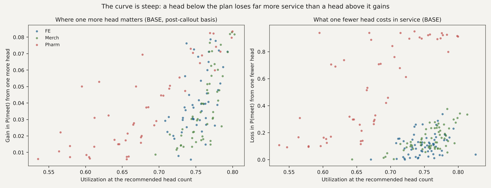
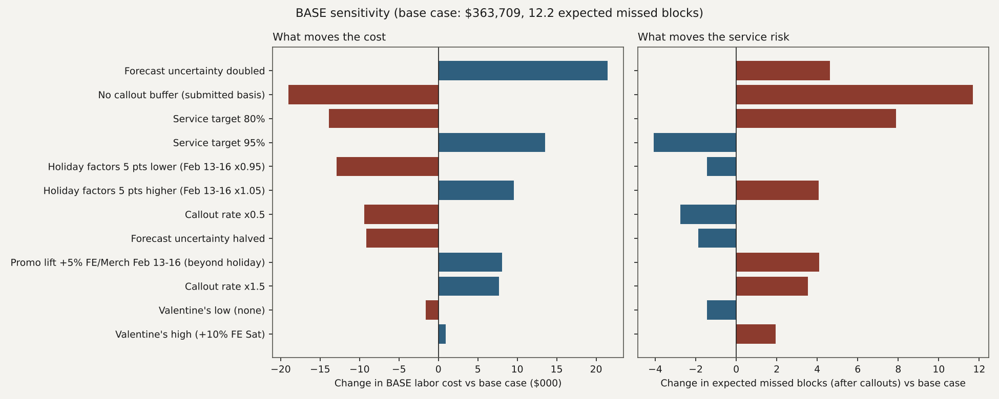

# MISA Costco case, Phase 2 report

Everything below is produced by `run_all.py --phase 2` from the Phase 1 outputs and the competition CSVs; file names in backticks are in `outputs/`.

## 4. Staffing optimizer

### How it works (two sentences for the slide)

The problem splits into 63 independent warehouse x date x shift problems, because the only coupling is the shared FE/Merch cross-trained pool inside a block and every availability limit is per block; so instead of an integer program we enumerate every feasible (FE, Merch) head pair exactly, cost it with the official fill rule, and pick the cheapest pair with both departments at the service target, Pharmacy being solved on its own. Where no pair reaches the target, the rule is service-first: minimise how far past the target the waits run (so no department is left dark), then expected misses, then cost, and the block is flagged.

P(meet) for a candidate head count averages the Step 1 curve over the forecast distribution (lognormal, block-level sd from the Phase 1 intervals, 7-point Gauss-Hermite) and, on the recommended basis, over the worked-heads distribution: callouts ~ Binomial(n, p), each callout backfilled with probability 0.5 while overtime room remains (history: 49% of callouts backfilled, variance ratio to binomial 0.93-1.04). Expected worked heads are never plugged in; the curve is too steep for that.

### Callout rates used (`04_callout_rates.csv`)

| dept | cat | scheduled | callouts | rate | se_rate | backfill_share | source |
|---|---|---|---|---|---|---|---|
| FE | post_holiday | 336 | 27 | 8.0% | 1.5% | 56% | history excl. W2 flu cluster Jan 22-28 |
| FE | weekday | 3912 | 195 | 5.0% | 0.3% | 46% | history excl. W2 flu cluster Jan 22-28 |
| FE | weekend | 2799 | 180 | 6.4% | 0.5% | 51% | history excl. W2 flu cluster Jan 22-28 |
| Merch | post_holiday | 250 | 10 | 4.0% | 1.2% | 50% | history excl. W2 flu cluster Jan 22-28 |
| Merch | weekday | 3309 | 112 | 3.4% | 0.3% | 56% | history excl. W2 flu cluster Jan 22-28 |
| Merch | weekend | 1714 | 95 | 5.5% | 0.6% | 43% | history excl. W2 flu cluster Jan 22-28 |
| Pharm | post_holiday | 82 | 9 | 11.0% | 3.5% | 44% | history excl. W2 flu cluster Jan 22-28 |
| Pharm | weekday | 999 | 29 | 2.9% | 0.5% | 48% | history excl. W2 flu cluster Jan 22-28 |
| Pharm | weekend | 132 | 8 | 6.1% | 2.1% | 12% | history excl. W2 flu cluster Jan 22-28 |
| FE | flu_cluster_W2 | 422 | 52 | 12.3% | 1.6% | 52% | W2 flu cluster only (not used for planning; DISRUPT illness is in availability) |
| Pharm | flu_cluster_W2 | 84 | 9 | 10.7% | 3.4% | 56% | W2 flu cluster only (not used for planning; DISRUPT illness is in availability) |

The Warehouse 2 flu cluster (Jan 22-28, FE 12.3%, Pharmacy 10.7%) is excluded from the base rates: DISRUPT's illness is already in its availability table, so adding a flu rate would double count. Post-holiday rates rest on two days (18 blocks per department) and are the least certain input; they only touch Tue Feb 17.

### Plans produced (`04_plan_summary.csv`)

| setting | scenario | basis | tau | valentine | heads | cost | ot_heads | flex_heads | exp_missed_submitted | exp_missed_post | blocks_below_tau_post | infeasible_strict |
|---|---|---|---|---|---|---|---|---|---|---|---|---|
| rec_post90 | BASE | post_callout | 0.90 | mid | 2628 | 363,709 | 227 | 19 | 2.0 | 12.2 | 17 | 0 |
| rec_post90 | PEAK | post_callout | 0.90 | mid | 2707 | 378,545 | 300 | 14 | 14.2 | 26.6 | 40 | 0 |
| rec_post90 | DISRUPT | post_callout | 0.90 | mid | 2523 | 353,856 | 223 | 22 | 10.8 | 20.6 | 27 | 0 |
| post80 | BASE | post_callout | 0.80 | mid | 2541 | 349,842 | 182 | 18 | 5.0 | 20.1 | 9 | 0 |
| post80 | PEAK | post_callout | 0.80 | mid | 2643 | 367,678 | 271 | 13 | 16.5 | 32.7 | 31 | 0 |
| post80 | DISRUPT | post_callout | 0.80 | mid | 2456 | 343,105 | 191 | 23 | 13.1 | 27.2 | 19 | 0 |
| post95 | BASE | post_callout | 0.95 | mid | 2708 | 377,216 | 265 | 19 | 0.9 | 8.1 | 30 | 0 |
| post95 | PEAK | post_callout | 0.95 | mid | 2759 | 387,634 | 315 | 14 | 13.5 | 23.5 | 48 | 0 |
| post95 | DISRUPT | post_callout | 0.95 | mid | 2593 | 365,632 | 255 | 22 | 9.8 | 17.1 | 40 | 0 |
| sub90 | BASE | submitted | 0.90 | mid | 2506 | 344,707 | 159 | 18 | 6.3 | 23.9 | 106 | 0 |
| sub90 | PEAK | submitted | 0.90 | mid | 2616 | 363,639 | 257 | 13 | 17.4 | 35.8 | 108 | 0 |
| sub90 | DISRUPT | submitted | 0.90 | mid | 2435 | 339,668 | 181 | 20 | 14.4 | 30.9 | 104 | 0 |
| post90_q80 | BASE | post_callout | 0.90 | mid | 2650 | 366,572 | 233 | 20 | 0.4 | 14.0 | 21 | 0 |
| post90_q80 | PEAK | post_callout | 0.90 | mid | 2669 | 372,877 | 246 | 32 | 16.4 | 30.8 | 43 | 0 |
| post90_q80 | DISRUPT | post_callout | 0.90 | mid | 2542 | 357,080 | 227 | 23 | 10.4 | 22.4 | 31 | 0 |
| post90_val_low | BASE | post_callout | 0.90 | low | 2618 | 362,096 | 217 | 19 | 1.7 | 10.8 | 14 | 0 |
| post90_val_low | PEAK | post_callout | 0.90 | low | 2700 | 377,072 | 293 | 15 | 10.8 | 24.3 | 39 | 0 |
| post90_val_low | DISRUPT | post_callout | 0.90 | low | 2517 | 352,882 | 217 | 22 | 10.4 | 19.6 | 26 | 0 |
| post90_val_high | BASE | post_callout | 0.90 | high | 2633 | 364,622 | 231 | 19 | 2.9 | 14.2 | 24 | 0 |
| post90_val_high | PEAK | post_callout | 0.90 | high | 2705 | 378,102 | 298 | 15 | 16.7 | 29.0 | 43 | 0 |
| post90_val_high | DISRUPT | post_callout | 0.90 | high | 2526 | 354,455 | 226 | 22 | 11.5 | 22.1 | 33 | 0 |

Recommended for submission: `rec_post90` (target 90%, evaluated after expected callouts, mid Valentine's). BASE: 2,628 heads, $363,709, 227 overtime heads (OT premium $8,822, 2.4% of cost), 2.0 expected missed blocks on submitted heads and 12.2 after callouts, 0 infeasible blocks. Saturday Feb 14 carries 500 heads vs 417 in the draft.

### Blocks that cannot reach 90% within capacity (`04_capacity_bound.csv`)

BASE 17, PEAK 40, DISRUPT 27 blocks. In BASE they are holiday-weekend blocks (plus two pharmacy blocks on Tue Feb 17) where the plan already uses every regular and every overtime head, so a callout cannot be backfilled; on submitted heads most of them sit at 0.95-0.99 and the shortfall is a post-callout one. In PEAK the Friday and Saturday FE MID/EVE and Saturday Merch OPEN blocks at all three warehouses exceed capacity outright (demand at +20-30% needs 1-8 more heads than exist); in DISRUPT the Warehouse 2 front-end midday blocks on Feb 13-15 are beyond help (90% needs 33-44 heads, capacity after illness is 23-34), so on Saturday their two cross-trained regulars go to Merch, lifting it from 0.89 to 0.99 at no loss to a front end that cannot be saved. The playbook names each block.

### What a higher or lower target costs (`04_threshold_cost.csv`)

| scenario | tau | cost | exp_missed_post | exp_missed_submitted | blocks_below_tau_post | ot_heads | heads | labor_hours |
|---|---|---|---|---|---|---|---|---|
| BASE | 0.80 | 349,842 | 20.1 | 5.0 | 9 | 182 | 2541 | 10926.0 |
| BASE | 0.90 | 363,709 | 12.2 | 2.0 | 17 | 227 | 2628 | 11299.0 |
| BASE | 0.95 | 377,216 | 8.1 | 0.9 | 30 | 265 | 2708 | 11638.0 |
| DISRUPT | 0.80 | 343,105 | 27.2 | 13.1 | 19 | 191 | 2456 | 10665.0 |
| DISRUPT | 0.90 | 353,856 | 20.6 | 10.8 | 27 | 223 | 2523 | 10954.0 |
| DISRUPT | 0.95 | 365,632 | 17.1 | 9.8 | 40 | 255 | 2593 | 11251.0 |
| PEAK | 0.80 | 367,678 | 32.7 | 16.5 | 31 | 271 | 2643 | 11385.0 |
| PEAK | 0.90 | 378,545 | 26.6 | 14.2 | 40 | 300 | 2707 | 11668.5 |
| PEAK | 0.95 | 387,634 | 23.5 | 13.5 | 48 | 315 | 2759 | 11899.5 |

Moving from 90% to 95% everywhere costs $13,507 in BASE (+3.7%) and removes 4.1 expected misses after callouts; dropping to 80% saves $13,867 and adds 7.9. The callout buffer itself (90% post-callout vs 90% on submitted heads) costs $19,002 (5.5%) and halves expected misses after callouts (23.9 to 12.2).

**Recommendation: submit the 90% post-callout plan.** Service is judged first, so the plan must survive callouts and a normal forecast miss: on submitted heads it has 0.0 expected misses at the forecast and 0.4 even if demand comes in 6% high (draft: 31 and 69); after callouts it holds 92-96%. The 95% plan buys about 4 expected blocks for $13,507; keep it as the fallback if the team learns that judges rank purely on hit rate with no cost tie-break.

### Marginal value (`04_marginal_value.csv`, chart `04_marginal_value.png`)

At the recommended BASE plan, one more head raises P(meet) by a median of 0.034 (90th percentile 0.072) for a median $178; one fewer head lowers it by a median of 0.148 (90th percentile 0.803). That asymmetry is the steep curve: heads below the plan cost far more service than heads above it buy.

## 5. Our plan vs the draft, and the six-week backtest

### The table for judges (`05_judges_table.csv`)

| scenario | plan | heads | cost | cost_ot | ot_heads | exp_missed_submitted | exp_missed_post | avg_p_post | blocks_below_90_post | infeasible_strict | cost_vs_draft_pct |
|---|---|---|---|---|---|---|---|---|---|---|---|
| BASE | Draft schedule (as given) | 2390 | 329,108 | 10,384 | 52 | 38.11 | 52.07 | 0.71 | 110 | 0 | +0.0% |
| BASE | Ours, 90% target (recommended) | 2628 | 363,709 | 36,394 | 227 | 2.04 | 12.22 | 0.93 | 17 | 0 | +10.5% |
| PEAK | Draft schedule (as given) | 2390 | 329,108 | 10,384 | 52 | 58.48 | 69.55 | 0.61 | 116 | 0 | +0.0% |
| PEAK | Ours, 90% target (recommended) | 2707 | 378,545 | 49,900 | 300 | 14.22 | 26.62 | 0.85 | 40 | 0 | +15.0% |
| DISRUPT | Draft schedule (as given) | 2390 | 326,367 | 17,848 | 96 | 38.11 | 52.63 | 0.71 | 110 | 12 | +0.0% |
| DISRUPT | Ours, 90% target (recommended) | 2523 | 353,856 | 38,345 | 223 | 10.77 | 20.63 | 0.89 | 27 | 0 | +8.4% |

Reading across: the draft spends less because it ignores the holiday weekend and callouts; it would miss 38 blocks in BASE even if nobody called out and 52 after callouts (hit rate 71%), 70 in PEAK, and in DISRUPT it is infeasible in 12 blocks. Our plan costs 10.5% more in BASE and reduces expected misses after callouts from 52 to 12.

### Full comparison (`05_plan_vs_draft.csv`)

| scenario | plan | heads | cost | cost_ot | ot_heads | flex_heads | exp_missed_submitted | exp_missed_post | avg_p_post | blocks_below_90_post | infeasible_strict | infeasible_loose | cost_vs_draft_pct |
|---|---|---|---|---|---|---|---|---|---|---|---|---|---|
| BASE | Draft schedule (as given) | 2390 | 329,108 | 10,384 | 52 | 19 | 38.11 | 52.07 | 0.71 | 110 | 0 | 0 | +0.0% |
| BASE | Draft capped at capacity | 2390 | 329,108 | 10,384 | 52 | 19 | 38.11 | 52.07 | 0.71 | 110 | 0 | 0 | +0.0% |
| BASE | Ours, 80% target | 2541 | 349,842 | 28,715 | 182 | 18 | 4.96 | 20.12 | 0.89 | 91 | 0 | 0 | +6.3% |
| BASE | Ours, 90% target (recommended) | 2628 | 363,709 | 36,394 | 227 | 19 | 2.04 | 12.22 | 0.93 | 17 | 0 | 0 | +10.5% |
| BASE | Ours, 95% target | 2708 | 377,216 | 43,647 | 265 | 19 | 0.93 | 8.14 | 0.95 | 17 | 0 | 0 | +14.6% |
| BASE | Ours, 90% on submitted heads (no callout buffer) | 2506 | 344,707 | 25,083 | 159 | 18 | 6.28 | 23.90 | 0.87 | 106 | 0 | 0 | +4.7% |
| BASE | Ours, 90% at the 80th demand percentile | 2650 | 366,572 | 37,176 | 233 | 20 | 0.36 | 14.05 | 0.92 | 21 | 0 | 0 | +11.4% |
| PEAK | Draft schedule (as given) | 2390 | 329,108 | 10,384 | 52 | 19 | 58.48 | 69.55 | 0.61 | 116 | 0 | 0 | +0.0% |
| PEAK | Draft capped at capacity | 2390 | 329,108 | 10,384 | 52 | 19 | 58.48 | 69.55 | 0.61 | 116 | 0 | 0 | +0.0% |
| PEAK | Ours, 80% target | 2643 | 367,678 | 44,035 | 271 | 13 | 16.47 | 32.73 | 0.82 | 94 | 0 | 0 | +11.7% |
| PEAK | Ours, 90% target (recommended) | 2707 | 378,545 | 49,900 | 300 | 14 | 14.22 | 26.62 | 0.85 | 40 | 0 | 0 | +15.0% |
| PEAK | Ours, 95% target | 2759 | 387,634 | 53,582 | 315 | 14 | 13.52 | 23.51 | 0.87 | 40 | 0 | 0 | +17.8% |
| PEAK | Ours, 90% on submitted heads (no callout buffer) | 2616 | 363,639 | 41,679 | 257 | 13 | 17.42 | 35.83 | 0.80 | 108 | 0 | 0 | +10.5% |
| PEAK | Ours, 90% at the 80th demand percentile | 2669 | 372,877 | 41,801 | 246 | 32 | 16.40 | 30.77 | 0.83 | 43 | 0 | 0 | +13.3% |
| DISRUPT | Draft schedule (as given) | 2390 | 326,367 | 17,848 | 96 | 21 | 38.11 | 52.63 | 0.71 | 110 | 12 | 12 | +0.0% |
| DISRUPT | Draft capped at capacity | 2361 | 326,367 | 17,848 | 96 | 21 | 40.07 | 54.15 | 0.70 | 114 | 5 | 0 | +0.0% |
| DISRUPT | Ours, 80% target | 2456 | 343,105 | 32,639 | 191 | 23 | 13.11 | 27.20 | 0.85 | 89 | 0 | 0 | +5.1% |
| DISRUPT | Ours, 90% target (recommended) | 2523 | 353,856 | 38,345 | 223 | 22 | 10.77 | 20.63 | 0.89 | 27 | 0 | 0 | +8.4% |
| DISRUPT | Ours, 95% target | 2593 | 365,632 | 44,513 | 255 | 22 | 9.83 | 17.10 | 0.91 | 27 | 0 | 0 | +12.0% |
| DISRUPT | Ours, 90% on submitted heads (no callout buffer) | 2435 | 339,668 | 30,753 | 181 | 20 | 14.38 | 30.85 | 0.83 | 104 | 0 | 0 | +4.1% |
| DISRUPT | Ours, 90% at the 80th demand percentile | 2542 | 357,080 | 39,433 | 227 | 23 | 10.37 | 22.36 | 0.88 | 31 | 0 | 0 | +9.4% |

`infeasible_strict` applies the README rule (flex limited to partner staff not in use); `infeasible_loose` is the `sql/05` S06/S07 check (flex counted in full). Our plans are feasible under both.

### Stress test: what if realised demand differs from the forecast (`05_stress_test.csv`)

Expected missed blocks after callouts when realised demand = forecast x multiplier (a realised week has no forecast spread):

| scenario | plan | missed @ x0.96 | missed @ x1.00 | missed @ x1.04 | missed @ x1.06 |
|---|---|---|---|---|---|
| BASE | 90% (recommended) | 3.5 | 6.7 | 13.5 | 20.0 |
| BASE | 90% no callout buffer | 6.5 | 14.2 | 29.6 | 43.1 |
| BASE | 95% | 2.2 | 4.6 | 9.2 | 13.2 |
| BASE | Draft | 29.8 | 48.2 | 71.8 | 84.0 |
| DISRUPT | 90% (recommended) | 12.4 | 15.9 | 22.7 | 28.7 |
| DISRUPT | 90% no callout buffer | 15.2 | 22.8 | 36.9 | 48.7 |
| DISRUPT | 95% | 11.2 | 14.1 | 18.7 | 22.6 |
| DISRUPT | Draft | 30.7 | 48.9 | 72.0 | 84.1 |
| PEAK | 90% (recommended) | 16.7 | 22.8 | 31.4 | 38.3 |
| PEAK | 90% no callout buffer | 19.4 | 29.3 | 44.1 | 56.3 |
| PEAK | 95% | 15.6 | 21.1 | 27.8 | 32.7 |
| PEAK | Draft | 55.3 | 68.9 | 84.4 | 93.6 |

Same, on submitted heads (no callouts):

| scenario | plan | missed @ x0.96 | missed @ x1.00 | missed @ x1.04 | missed @ x1.06 |
|---|---|---|---|---|---|
| BASE | 90% (recommended) | 0.0 | 0.0 | 0.0 | 0.4 |
| BASE | Draft | 16.4 | 31.3 | 55.0 | 68.8 |
| DISRUPT | 90% (recommended) | 8.0 | 8.3 | 9.6 | 10.8 |
| DISRUPT | Draft | 16.4 | 31.3 | 55.0 | 68.8 |
| PEAK | 90% (recommended) | 7.1 | 13.4 | 15.9 | 18.2 |
| PEAK | Draft | 44.8 | 58.3 | 72.6 | 81.5 |

### Six-week backtest: our method vs what managers did (`05_backtest_summary.csv`, `05_backtest_weekly.csv`)

Setup: for each historical week the service curve is refitted on the other five weeks, the forecast is built from the other five weeks (level = their mean; the MLK window in week 3 has no analog in the other weeks, so the New Year rebound factors stand in), callout rates come from the other weeks, availability is the week's own, and the optimizer runs exactly as for the planning week. Both plans are then scored against the week's ACTUAL demand with that week's held-out curve. Managers' misses are realised; ours are model-expected; the model's expected misses for the managers' own schedule are shown as the calibration check.

| tau | basis | mgr_cost_realised | mgr_missed_realised | mgr_exp_missed_model_post | ours_cost_exp_realised | cost_change_pct | ours_exp_missed_model_post | ours_exp_missed_model_sub | ours_hit_rate_model_post | excl_w3_cost_change_pct | excl_w3_mgr_missed | excl_w3_ours_exp_missed_post |
|---|---|---|---|---|---|---|---|---|---|---|---|---|
| 0.70 | post_callout | 1,890,242 | 233.0 | 223.1 | 1,835,541 | -2.9% | 203.7 | 111.2 | 0.8 | -2.7% | 154 | 108.3 |
| 0.80 | post_callout | 1,890,242 | 233.0 | 223.1 | 1,875,848 | -0.8% | 154.8 | 77.5 | 0.9 | -0.5% | 154 | 72.9 |
| 0.90 | post_callout | 1,890,242 | 233.0 | 223.1 | 1,943,913 | +2.8% | 90.6 | 36.1 | 0.9 | +3.0% | 154 | 35.6 |
| 0.90 | submitted | 1,890,242 | 233.0 | 223.1 | 1,865,098 | -1.3% | 172.6 | 89.7 | 0.8 | -1.1% | 154 | 84.7 |
| 0.95 | post_callout | 1,890,242 | 233.0 | 223.1 | 2,011,107 | +6.4% | 53.4 | 17.2 | 0.9 | +6.5% | 154 | 17.9 |

Reading: managers spent $1,890,242 and missed 233 of 1,053 blocks (hit rate 77.9%). The model, given their schedules, expects 223 misses, within 4% of what happened. Our method at the 90% target would have spent +2.8% (expected realised cost, callouts unpaid and backfills paid) and missed about 91 (hit rate 91.4%); at the 80% target it would have cost -0.8% and missed 155; at 70%, -2.9% and 204. So at the managers' own spend the method misses about a third fewer blocks, and for 3% more it misses 60% fewer. Week 3 (MLK) is the hard week for both: a +5.5% week on a holiday whose factors the backtest could not know; excluding it, the 90% plan costs +3.0% and misses 36 vs 154.

| week | forecast_wape | mgr_cost_realised | mgr_missed_realised | mgr_exp_missed_model_post | ours_cost_exp_realised | ours_exp_missed_model_post | ours_heads | mgr_heads |
|---|---|---|---|---|---|---|---|---|
| 1 | 6.8% | 276,278 | 33 | 29.0 | 289,290 | 8.3 | 2170 | 2076 |
| 2 | 3.5% | 321,431 | 33 | 31.8 | 331,023 | 6.3 | 2466 | 2385 |
| 3 | 10.4% | 323,037 | 79 | 78.4 | 329,494 | 55.0 | 2458 | 2395 |
| 4 | 3.5% | 320,328 | 36 | 33.4 | 331,578 | 6.2 | 2461 | 2381 |
| 5 | 5.1% | 324,831 | 19 | 14.2 | 332,751 | 3.0 | 2475 | 2408 |
| 6 | 3.6% | 324,337 | 33 | 36.4 | 329,777 | 11.8 | 2451 | 2394 |

**Remaining circularity, stated plainly.** (1) The service curve used to score our plan has the same functional form as the one we optimised against; leave-one-week-out removes the sample overlap, not the model-form assumption. (2) Our misses are expectations under that curve, the managers' are realised draws; the calibration check (223 expected vs 233 realised for their schedules) is the evidence that the two are comparable. (3) The Phase 1 diagnosis ($129K surplus vs $71K deficit) used actual demand; the backtest uses forecasts and callout buffers, which is why the cost advantage shrinks to roughly break-even at the 80% target. We say this on the slide rather than let a judge find it.

## 6. Leader playbook

The one-page playbook is `06_playbook.md` (reproduced below); block-level triggers are in `06_playbook_blocks.csv`.

### Leader playbook, planning week Feb 12-18 (one page)

Every number below comes from the fitted service curve and the recommended plan (`outputs/06_*.csv`). 'Tolerance' = callouts a block can absorb before P(meet target) drops below 80%. Base plan heads already include the expected-callout buffer.

#### 1. Daily rules by warehouse (BASE plan)

| Warehouse | Dept | Shift | Days | Plan heads | Expected callouts | Tolerance (80% / 50%) | Flex you can pull | OT room | Action |
|---|---|---|---|---|---|---|---|---|---|
| 1 | FE | EVE | weekday | 16 | 0.9 | 2 / 2 | 0 | 3 | then OT up to 3 head(s) (+$37/head); beyond that: accept risk, see escalation table |
| 1 | FE | MID | weekday | 17 | 1.1 | 2 / 3 | 0 | 0 | OT already fully used in the plan: no backfill room; beyond that: accept risk, see escalation table |
| 1 | FE | OPEN | weekday | 10 | 0.6 | 1 / 2 | 0 | 2 | then OT up to 2 head(s) (+$37/head); beyond that: accept risk, see escalation table |
| 1 | FE | EVE | weekend | 24 | 1.6 | 2 / 4 | 0 | 0 | OT already fully used in the plan: no backfill room; beyond that: accept risk, see escalation table |
| 1 | FE | MID | weekend | 35 | 2.3 | 1 / 3 | 1 | 0 | pull up to 1 cross-trained from Merch (partner stays >= 90%); OT already fully used in the plan: no backfill room; beyond that: accept risk, see escalation table |
| 1 | FE | OPEN | weekend | 26 | 1.7 | 4 / 5 | 0 | 0 | OT already fully used in the plan: no backfill room; beyond that: accept risk, see escalation table |
| 1 | Merch | EVE | weekday | 11 | 0.4 | 2 / 2 | 0 | 1 | then OT up to 1 head(s) (+$58/head); beyond that: accept risk, see escalation table |
| 1 | Merch | MID | weekday | 11 | 0.4 | 1 / 2 | 1 | 1 | pull up to 1 cross-trained from FE (partner stays >= 90%); then OT up to 1 head(s) (+$48/head); beyond that: accept risk, see escalation table |
| 1 | Merch | OPEN | weekday | 16 | 0.6 | 1 / 2 | 0 | 1 | then OT up to 1 head(s) (+$58/head); beyond that: accept risk, see escalation table |
| 1 | Merch | EVE | weekend | 11 | 0.6 | 1 / 1 | 1 | 0 | pull up to 1 cross-trained from FE (partner stays >= 90%); OT already fully used in the plan: no backfill room; beyond that: accept risk, see escalation table |
| 1 | Merch | MID | weekend | 17 | 0.9 | 2 / 3 | 0 | 0 | OT already fully used in the plan: no backfill room; beyond that: accept risk, see escalation table |
| 1 | Merch | OPEN | weekend | 19 | 1.1 | 1 / 2 | 2 | 0 | pull up to 2 cross-trained from FE (partner stays >= 90%); OT already fully used in the plan: no backfill room; beyond that: accept risk, see escalation table |
| 1 | Pharm | EVE | weekday | 4 | 0.2 | 1 / 1 | 0 | 0 | OT already fully used in the plan: no backfill room; beyond that: accept risk, see escalation table |
| 1 | Pharm | MID | weekday | 4 | 0.2 | 1 / 1 | 0 | 1 | then OT up to 1 head(s) (+$48/head); beyond that: accept risk, see escalation table |
| 1 | Pharm | OPEN | weekday | 4 | 0.2 | 1 / 1 | 0 | 0 | OT already fully used in the plan: no backfill room; beyond that: accept risk, see escalation table |
| 1 | Pharm | MID | weekend | 2 | 0.1 | 1 / 1 | 0 | 1 | then OT up to 1 head(s) (+$80/head); beyond that: accept risk, see escalation table |
| 1 | Pharm | OPEN | weekend | 3 | 0.2 | 1 / 1 | 0 | 1 | then OT up to 1 head(s) (+$64/head); beyond that: accept risk, see escalation table |
| 2 | FE | EVE | weekday | 20 | 1.2 | 2 / 3 | 0 | 3 | then OT up to 3 head(s) (+$38/head); beyond that: accept risk, see escalation table |
| 2 | FE | MID | weekday | 21 | 1.3 | 2 / 3 | 0 | 0 | OT already fully used in the plan: no backfill room; beyond that: accept risk, see escalation table |
| 2 | FE | OPEN | weekday | 12 | 0.7 | 2 / 2 | 1 | 4 | pull up to 1 cross-trained from Merch (partner stays >= 90%); then OT up to 4 head(s) (+$38/head); beyond that: accept risk, see escalation table |
| 2 | FE | EVE | weekend | 29 | 1.9 | 2 / 4 | 1 | 0 | pull up to 1 cross-trained from Merch (partner stays >= 90%); OT already fully used in the plan: no backfill room; beyond that: accept risk, see escalation table |
| 2 | FE | MID | weekend | 45 | 2.9 | 3 / 6 | 1 | 0 | pull up to 1 cross-trained from Merch (partner stays >= 90%); OT already fully used in the plan: no backfill room; beyond that: accept risk, see escalation table |
| 2 | FE | OPEN | weekend | 31 | 2.0 | 3 / 5 | 1 | 0 | pull up to 1 cross-trained from Merch (partner stays >= 90%); OT already fully used in the plan: no backfill room; beyond that: accept risk, see escalation table |
| 2 | Merch | EVE | weekday | 13 | 0.5 | 1 / 2 | 1 | 4 | pull up to 1 cross-trained from FE (partner stays >= 90%); then OT up to 4 head(s) (+$60/head); beyond that: accept risk, see escalation table |
| 2 | Merch | MID | weekday | 13 | 0.5 | 1 / 2 | 0 | 4 | then OT up to 4 head(s) (+$50/head); beyond that: accept risk, see escalation table |
| 2 | Merch | OPEN | weekday | 20 | 0.7 | 2 / 3 | 0 | 2 | then OT up to 2 head(s) (+$60/head); beyond that: accept risk, see escalation table |
| 2 | Merch | EVE | weekend | 15 | 0.8 | 3 / 4 | 0 | 0 | OT already fully used in the plan: no backfill room; beyond that: accept risk, see escalation table |
| 2 | Merch | MID | weekend | 19 | 1.1 | 2 / 3 | 1 | 0 | pull up to 1 cross-trained from FE (partner stays >= 90%); OT already fully used in the plan: no backfill room; beyond that: accept risk, see escalation table |
| 2 | Merch | OPEN | weekend | 25 | 1.4 | 2 / 4 | 2 | 0 | pull up to 2 cross-trained from FE (partner stays >= 90%); OT already fully used in the plan: no backfill room; beyond that: accept risk, see escalation table |
| 2 | Pharm | EVE | weekday | 4 | 0.2 | 1 / 1 | 0 | 1 | then OT up to 1 head(s) (+$58/head); beyond that: accept risk, see escalation table |
| 2 | Pharm | MID | weekday | 4 | 0.2 | 1 / 1 | 0 | 1 | then OT up to 1 head(s) (+$50/head); beyond that: accept risk, see escalation table |
| 2 | Pharm | OPEN | weekday | 5 | 0.2 | 1 / 1 | 0 | 1 | then OT up to 1 head(s) (+$58/head); beyond that: accept risk, see escalation table |
| 2 | Pharm | MID | weekend | 2 | 0.2 | 1 / 1 | 0 | 1 | then OT up to 1 head(s) (+$83/head); beyond that: accept risk, see escalation table |
| 2 | Pharm | OPEN | weekend | 3 | 0.2 | 1 / 1 | 0 | 1 | then OT up to 1 head(s) (+$67/head); beyond that: accept risk, see escalation table |
| 4 | FE | EVE | weekday | 21 | 1.2 | 2 / 3 | 0 | 3 | then OT up to 3 head(s) (+$38/head); beyond that: accept risk, see escalation table |
| 4 | FE | MID | weekday | 22 | 1.3 | 2 / 3 | 0 | 0 | OT already fully used in the plan: no backfill room; beyond that: accept risk, see escalation table |
| 4 | FE | OPEN | weekday | 12 | 0.7 | 1 / 2 | 0 | 4 | then OT up to 4 head(s) (+$38/head); beyond that: accept risk, see escalation table |
| 4 | FE | EVE | weekend | 31 | 2.0 | 3 / 5 | 0 | 0 | OT already fully used in the plan: no backfill room; beyond that: accept risk, see escalation table |
| 4 | FE | MID | weekend | 48 | 3.1 | 4 / 7 | 0 | 0 | OT already fully used in the plan: no backfill room; beyond that: accept risk, see escalation table |
| 4 | FE | OPEN | weekend | 32 | 2.1 | 3 / 5 | 1 | 1 | pull up to 1 cross-trained from Merch (partner stays >= 90%); then OT up to 1 head(s) (+$38/head); beyond that: accept risk, see escalation table |
| 4 | Merch | EVE | weekday | 13 | 0.5 | 1 / 2 | 1 | 3 | pull up to 1 cross-trained from FE (partner stays >= 90%); then OT up to 3 head(s) (+$59/head); beyond that: accept risk, see escalation table |
| 4 | Merch | MID | weekday | 13 | 0.5 | 1 / 2 | 1 | 4 | pull up to 1 cross-trained from FE (partner stays >= 90%); then OT up to 4 head(s) (+$49/head); beyond that: accept risk, see escalation table |
| 4 | Merch | OPEN | weekday | 19 | 0.7 | 2 / 2 | 0 | 2 | then OT up to 2 head(s) (+$59/head); beyond that: accept risk, see escalation table |
| 4 | Merch | EVE | weekend | 13 | 0.7 | 1 / 2 | 2 | 0 | pull up to 2 cross-trained from FE (partner stays >= 90%); OT already fully used in the plan: no backfill room; beyond that: accept risk, see escalation table |
| 4 | Merch | MID | weekend | 18 | 1.0 | 2 / 3 | 2 | 0 | pull up to 2 cross-trained from FE (partner stays >= 90%); OT already fully used in the plan: no backfill room; beyond that: accept risk, see escalation table |
| 4 | Merch | OPEN | weekend | 24 | 1.3 | 2 / 3 | 2 | 2 | pull up to 2 cross-trained from FE (partner stays >= 90%); then OT up to 2 head(s) (+$51/head); beyond that: accept risk, see escalation table |
| 4 | Pharm | EVE | weekday | 5 | 0.2 | 1 / 1 | 0 | 1 | then OT up to 1 head(s) (+$57/head); beyond that: accept risk, see escalation table |
| 4 | Pharm | MID | weekday | 5 | 0.2 | 1 / 1 | 0 | 0 | OT already fully used in the plan: no backfill room; beyond that: accept risk, see escalation table |
| 4 | Pharm | OPEN | weekday | 5 | 0.2 | 1 / 1 | 0 | 1 | then OT up to 1 head(s) (+$57/head); beyond that: accept risk, see escalation table |
| 4 | Pharm | MID | weekend | 2 | 0.2 | 1 / 1 | 0 | 1 | then OT up to 1 head(s) (+$82/head); beyond that: accept risk, see escalation table |
| 4 | Pharm | OPEN | weekend | 3 | 0.2 | 1 / 1 | 0 | 0 | OT already fully used in the plan: no backfill room; beyond that: accept risk, see escalation table |

How to read a row: if callouts in that block exceed the 80% tolerance before the shift starts, act in the order shown. A tolerance of 0 means the block is already at its planning limit (usually all OT used): the first callout needs an action.

#### 2. Scenario switches

**Storm advisory upgraded or promotion confirmed (switch to the PEAK plan).** Heads to add vs BASE, by warehouse and day:

| Warehouse | Date | Dept | BASE heads | PEAK heads | Add |
|---|---|---|---|---|---|
| 1 | 2026-02-13 | FE | 65 | 69 | +4 |
| 1 | 2026-02-13 | Merch | 41 | 50 | +9 |
| 1 | 2026-02-13 | Pharm | 11 | 12 | +1 |
| 1 | 2026-02-15 | FE | 83 | 87 | +4 |
| 1 | 2026-02-15 | Merch | 46 | 50 | +4 |
| 2 | 2026-02-13 | FE | 81 | 86 | +5 |
| 2 | 2026-02-13 | Merch | 49 | 59 | +10 |
| 2 | 2026-02-13 | Pharm | 12 | 13 | +1 |
| 2 | 2026-02-14 | Pharm | 5 | 6 | +1 |
| 2 | 2026-02-15 | FE | 101 | 106 | +5 |
| 2 | 2026-02-15 | Merch | 59 | 60 | +1 |
| 4 | 2026-02-13 | FE | 83 | 87 | +4 |
| 4 | 2026-02-13 | Merch | 49 | 64 | +15 |
| 4 | 2026-02-13 | Pharm | 13 | 14 | +1 |
| 4 | 2026-02-14 | FE | 119 | 120 | +1 |
| 4 | 2026-02-14 | Merch | 57 | 59 | +2 |
| 4 | 2026-02-14 | Pharm | 5 | 6 | +1 |
| 4 | 2026-02-15 | FE | 105 | 112 | +7 |
| 4 | 2026-02-15 | Merch | 55 | 58 | +3 |

Pre-stock on Thursday Feb 12 EVE: Merch Thursday evening blocks run at utilization W1 0.72 (10 heads, OT room 3), W2 0.74 (12 heads, OT room 4), W4 0.78 (11 heads, OT room 3). Each extra head there carries about 5 Merch workload units at the standard (6 h x 0.83 units/h), which is what one Friday OPEN head would otherwise carry. Moving receiving work to Thursday evening is the cheapest lever because Thursday OT room is unused and Friday/Saturday OPEN blocks are at capacity in PEAK.

**Illness cluster or crew shortage reported (switch to the DISRUPT plan).** Blocks that change vs BASE:

| Warehouse | Date | Shift | Dept | BASE | DISRUPT | Change | P(meet) in DISRUPT |
|---|---|---|---|---|---|---|---|
| 2 | 2026-02-13 | EVE | FE | 29 | 22 | -7 | 0.01 |
| 2 | 2026-02-13 | EVE | Merch | 14 | 13 | -1 | 0.73 |
| 2 | 2026-02-13 | MID | FE | 35 | 22 | -13 | 0.00 |
| 2 | 2026-02-13 | MID | Merch | 14 | 20 | +6 | 1.00 |
| 2 | 2026-02-13 | OPEN | FE | 17 | 15 | -2 | 0.39 |
| 2 | 2026-02-13 | OPEN | Merch | 21 | 20 | -1 | 0.88 |
| 2 | 2026-02-14 | EVE | FE | 32 | 16 | -16 | 0.00 |
| 2 | 2026-02-14 | EVE | Merch | 16 | 17 | +1 | 0.99 |
| 2 | 2026-02-14 | MID | FE | 45 | 23 | -22 | 0.00 |
| 2 | 2026-02-14 | MID | Merch | 19 | 21 | +2 | 0.99 |
| 2 | 2026-02-14 | OPEN | FE | 34 | 17 | -17 | 0.00 |
| 2 | 2026-02-14 | OPEN | Merch | 25 | 26 | +1 | 0.91 |
| 2 | 2026-02-15 | EVE | FE | 27 | 13 | -14 | 0.00 |
| 2 | 2026-02-15 | EVE | Merch | 14 | 15 | +1 | 0.99 |
| 2 | 2026-02-15 | MID | FE | 45 | 33 | -12 | 0.00 |
| 2 | 2026-02-15 | MID | Merch | 19 | 20 | +1 | 0.95 |
| 2 | 2026-02-15 | OPEN | FE | 29 | 15 | -14 | 0.00 |
| 2 | 2026-02-15 | OPEN | Merch | 26 | 27 | +1 | 0.99 |
| 2 | 2026-02-16 | MID | FE | 21 | 19 | -2 | 0.43 |
| 2 | 2026-02-16 | MID | Merch | 16 | 18 | +2 | 1.00 |
| 2 | 2026-02-16 | OPEN | Pharm | 4 | 3 | -1 | 0.80 |
| 4 | 2026-02-13 | OPEN | FE | 18 | 21 | +3 | 1.00 |
| 4 | 2026-02-13 | OPEN | Merch | 20 | 19 | -1 | 0.68 |

**Pharmacy cannot flex.** Pharmacy has no cross-trained cover and min_staff 2. When a pharmacy team member is out, OT is the only lever: protect pharmacy first because one missing head on a 3-4 head block moves P(meet) from above 0.95 to below 0.5 (see `06_playbook_blocks.csv`, p_after_1_callout).

#### 3. Escalation order and what each step costs

| Dept | 1. Reallocate within dept | 2. Cross-train | 3. Overtime (premium per head-shift) | 4. Accept risk (P(meet) lost per head short, median / bad case) |
|---|---|---|---|---|
| FE | move a head between shifts of the same day: $0 (same rate), limited by availability | pull a cross-trained partner head: $0 premium; partner loses the P(meet) shown in 06_playbook_blocks | $36 on top of $111 | 0.11 / 0.22 |
| Merch | move a head between shifts of the same day: $0 (same rate), limited by availability | pull a cross-trained partner head: $0 premium; partner loses the P(meet) shown in 06_playbook_blocks | $53 on top of $165 | 0.13 / 0.28 |
| Pharm | move a head between shifts of the same day: $0 (same rate), limited by availability | not available (licensure) | $58 on top of $181 | 0.57 / 0.93 |

Rule of thumb from the curve: a head short on a block at the 90% line costs 0.1-0.4 of a block's P(meet); a head of OT costs $35-70 of premium. At $35-70 per head against a 10-40 point drop in P(meet), OT is almost always worth it on a block at its planning limit, and never worth it on a block with slack (tolerance >= 2).

#### 4. Blocks to watch (recommended plan, P(meet) after callouts below 80%)

| Scenario | Warehouse | Date | Shift | Dept | Heads | Capacity | P(meet) submitted | P(meet) after callouts | Why |
|---|---|---|---|---|---|---|---|---|---|
| BASE | 1 | 2026-02-14 | MID | FE | 34 | 35 | 0.83 | 0.54 | all OT used, no backfill room |
| BASE | 1 | 2026-02-14 | EVE | Merch | 11 | 13 | 0.89 | 0.60 | all OT used, no backfill room |
| BASE | 1 | 2026-02-17 | OPEN | Pharm | 4 | 4 | 1.00 | 0.64 | all OT used, no backfill room |
| BASE | 2 | 2026-02-14 | EVE | FE | 32 | 33 | 0.95 | 0.71 | all OT used, no backfill room |
| BASE | 1 | 2026-02-14 | OPEN | Merch | 20 | 22 | 0.96 | 0.71 | all OT used, no backfill room |
| BASE | 2 | 2026-02-14 | MID | FE | 45 | 46 | 0.97 | 0.77 | all OT used, no backfill room |
| BASE | 1 | 2026-02-15 | OPEN | Merch | 19 | 21 | 0.97 | 0.77 | all OT used, no backfill room |
| BASE | 4 | 2026-02-14 | EVE | Merch | 14 | 16 | 0.97 | 0.78 | all OT used, no backfill room |
| BASE | 4 | 2026-02-14 | OPEN | Pharm | 3 | 3 | 0.96 | 0.80 | all OT used, no backfill room |
| DISRUPT | 2 | 2026-02-14 | OPEN | FE | 17 | 23 | 0.00 | 0.00 | capacity-bound |
| DISRUPT | 2 | 2026-02-14 | MID | FE | 23 | 30 | 0.00 | 0.00 | capacity-bound |
| DISRUPT | 2 | 2026-02-14 | EVE | FE | 16 | 21 | 0.00 | 0.00 | capacity-bound |
| DISRUPT | 2 | 2026-02-15 | OPEN | FE | 15 | 21 | 0.00 | 0.00 | capacity-bound |
| DISRUPT | 2 | 2026-02-15 | EVE | FE | 13 | 18 | 0.00 | 0.00 | capacity-bound |
| DISRUPT | 2 | 2026-02-13 | MID | FE | 22 | 23 | 0.00 | 0.00 | demand exceeds capacity even with all OT |
| DISRUPT | 2 | 2026-02-15 | MID | FE | 33 | 34 | 0.00 | 0.00 | demand exceeds capacity even with all OT |
| DISRUPT | 2 | 2026-02-13 | EVE | FE | 22 | 22 | 0.03 | 0.01 | demand exceeds capacity even with all OT |
| DISRUPT | 2 | 2026-02-13 | OPEN | FE | 15 | 15 | 0.63 | 0.39 | all OT used, no backfill room |
| DISRUPT | 2 | 2026-02-16 | MID | FE | 19 | 20 | 0.71 | 0.43 | all OT used, no backfill room |
| DISRUPT | 1 | 2026-02-14 | MID | FE | 34 | 35 | 0.83 | 0.54 | all OT used, no backfill room |
| DISRUPT | 1 | 2026-02-14 | EVE | Merch | 11 | 13 | 0.89 | 0.60 | all OT used, no backfill room |
| DISRUPT | 1 | 2026-02-17 | OPEN | Pharm | 4 | 4 | 1.00 | 0.64 | all OT used, no backfill room |
| DISRUPT | 4 | 2026-02-13 | OPEN | Merch | 19 | 20 | 0.82 | 0.68 | all OT used, no backfill room |
| DISRUPT | 1 | 2026-02-14 | OPEN | Merch | 20 | 22 | 0.96 | 0.71 | all OT used, no backfill room |
| DISRUPT | 2 | 2026-02-13 | EVE | Merch | 13 | 19 | 0.82 | 0.73 | capacity-bound |
| DISRUPT | 1 | 2026-02-15 | OPEN | Merch | 19 | 21 | 0.97 | 0.77 | all OT used, no backfill room |
| DISRUPT | 4 | 2026-02-14 | EVE | Merch | 14 | 16 | 0.97 | 0.78 | all OT used, no backfill room |
| DISRUPT | 4 | 2026-02-14 | OPEN | Pharm | 3 | 3 | 0.96 | 0.80 | all OT used, no backfill room |
| PEAK | 4 | 2026-02-13 | MID | FE | 34 | 35 | 0.03 | 0.01 | demand exceeds capacity even with all OT |
| PEAK | 1 | 2026-02-14 | OPEN | Merch | 20 | 22 | 0.03 | 0.01 | all OT used, no backfill room |
| PEAK | 1 | 2026-02-14 | MID | FE | 34 | 35 | 0.03 | 0.01 | demand exceeds capacity even with all OT |
| PEAK | 2 | 2026-02-14 | OPEN | Merch | 25 | 27 | 0.04 | 0.02 | all OT used, no backfill room |
| PEAK | 2 | 2026-02-14 | MID | FE | 45 | 46 | 0.24 | 0.06 | demand exceeds capacity even with all OT |
| PEAK | 2 | 2026-02-14 | EVE | FE | 32 | 33 | 0.26 | 0.09 | demand exceeds capacity even with all OT |
| PEAK | 4 | 2026-02-14 | OPEN | Merch | 27 | 29 | 0.26 | 0.11 | all OT used, no backfill room |
| PEAK | 4 | 2026-02-14 | EVE | FE | 35 | 36 | 0.27 | 0.12 | demand exceeds capacity even with all OT |
| PEAK | 4 | 2026-02-14 | MID | FE | 50 | 51 | 0.29 | 0.12 | demand exceeds capacity even with all OT |
| PEAK | 2 | 2026-02-13 | MID | FE | 35 | 35 | 0.30 | 0.16 | demand exceeds capacity even with all OT |
| PEAK | 4 | 2026-02-14 | MID | Merch | 18 | 22 | 0.30 | 0.16 | all OT used, no backfill room |
| PEAK | 1 | 2026-02-13 | MID | FE | 28 | 28 | 0.31 | 0.17 | demand exceeds capacity even with all OT |
| PEAK | 1 | 2026-02-14 | EVE | Merch | 11 | 13 | 0.35 | 0.20 | all OT used, no backfill room |
| PEAK | 4 | 2026-02-14 | EVE | Merch | 14 | 16 | 0.50 | 0.29 | all OT used, no backfill room |
| PEAK | 4 | 2026-02-13 | EVE | FE | 32 | 33 | 0.59 | 0.29 | all OT used, no backfill room |
| PEAK | 1 | 2026-02-14 | EVE | FE | 28 | 28 | 0.73 | 0.41 | all OT used, no backfill room |
| PEAK | 4 | 2026-02-14 | OPEN | FE | 35 | 37 | 0.74 | 0.46 | all OT used, no backfill room |
| PEAK | 2 | 2026-02-14 | MID | Merch | 19 | 22 | 0.74 | 0.51 | all OT used, no backfill room |
| PEAK | 1 | 2026-02-15 | OPEN | Merch | 19 | 21 | 0.79 | 0.54 | all OT used, no backfill room |
| PEAK | 4 | 2026-02-14 | OPEN | Pharm | 3 | 3 | 0.77 | 0.64 | all OT used, no backfill room |
| PEAK | 1 | 2026-02-17 | OPEN | Pharm | 4 | 4 | 1.00 | 0.64 | all OT used, no backfill room |
| PEAK | 1 | 2026-02-14 | OPEN | FE | 27 | 28 | 0.94 | 0.65 | all OT used, no backfill room |
| PEAK | 2 | 2026-02-13 | EVE | FE | 32 | 33 | 0.88 | 0.66 | all OT used, no backfill room |
| PEAK | 2 | 2026-02-15 | OPEN | FE | 29 | 31 | 0.94 | 0.67 | all OT used, no backfill room |
| PEAK | 2 | 2026-02-14 | OPEN | FE | 34 | 36 | 0.93 | 0.67 | all OT used, no backfill room |
| PEAK | 1 | 2026-02-13 | MID | Merch | 12 | 18 | 0.80 | 0.71 | capacity-bound |
| PEAK | 2 | 2026-02-15 | EVE | FE | 27 | 28 | 0.95 | 0.72 | all OT used, no backfill room |
| PEAK | 1 | 2026-02-13 | EVE | FE | 26 | 27 | 0.95 | 0.74 | all OT used, no backfill room |
| PEAK | 4 | 2026-02-15 | MID | FE | 49 | 50 | 0.97 | 0.76 | all OT used, no backfill room |
| PEAK | 4 | 2026-02-15 | EVE | Merch | 13 | 15 | 0.97 | 0.77 | all OT used, no backfill room |
| PEAK | 1 | 2026-02-15 | MID | FE | 38 | 39 | 0.97 | 0.79 | all OT used, no backfill room |

## 7. Proof-of-concept tool

`app.py` (single file, Streamlit) plus the static backup `outputs/poc_static.html`. Run: `pip install -r requirements.txt` then `streamlit run app.py` from the bundle folder; it reads only `data/` and `outputs/` and imports the staffing mechanics from `pipeline/engine.py`, the same code that produced the submission. The user picks a scenario, sets the service-confidence target, a callout-rate multiplier and per warehouse x department x day demand multipliers; the plan is re-optimised (about 3 s) and shown as warehouse x department by day x shift heatmaps (recommended heads, change vs draft, P(meet) on both bases, utilization, cost), with a 'why' card for any block (forecast and interval, required hours, expected callouts, chosen heads, regular/flex/OT fill and cost, P(meet) both bases, what +/-1 and +/-2 heads would do, and a sentence explaining capacity-bound or released-to-partner cases) and a download of the 567-row submission CSV. Tested with Streamlit's AppTest harness: no exceptions across scenario, target, basis, heatmap and block changes; the live BASE plan equals `04_plan_recommended.csv` head for head.

Design rules from the brief, checked against the app and the static page:

| Rule | Status |
|---|---|
| Color: no harsh gradients, pure white, rainbow, neon, basic pastels, purple/black, radial orbs | Off-white #f4f3ef background; one muted blue sequential scale, one muted brown-blue diverging scale, one muted red-green risk scale; no gradients or orbs |
| Layout: no 3 feature cards in a row, bento grids, pricing tiers, colored left stripes, dot grids, fake terminals | Plain tables and one heatmap at a time; the six summary metrics are a single row of bordered boxes, not feature cards; no stripes, grids or terminals |
| Styling: no drop shadows, soft rounded corners, liquid glass | border-radius 0 forced by CSS; no shadows; no blur |
| Fonts: not Inter, Geist, Space Grotesk | Helvetica / Arial (app) and DejaVu Sans (charts) |
| Icons and motion: no Lucide/sparkle icons, emojis, animated arrows, hover animations, skeleton loaders | No icons, no emoji, no animation; Streamlit's default spinner text is replaced by a plain sentence |
| Copy: no em dashes, 'it's not X, it's Y', checkmark bullets, fake testimonials | Checked by search: zero em dashes in app.py, poc_static.html and the reports; no testimonials or invented quotes |
| Content: no placeholder or mock demos; every number from the real pipeline | The app recomputes from pipeline outputs with the pipeline's engine; the static page is generated from the same CSVs |

## 8. Submission CSV (`outputs/TEAM_SUBMISSION.csv`, checks in `08_submission_checks.csv`)

| check | expected | actual | status |
|---|---|---|---|
| row count | 567 | 567 | PASS |
| columns identical to template (names and order) | team_id|scenario_id|scenario_code|store_id|dept_id|department_group|day_date|day_name|shift_code|is_open|min_staff|draft_scheduled_employees|submitted_employees | team_id|scenario_id|scenario_code|store_id|dept_id|department_group|day_date|day_name|shift_code|is_open|min_staff|draft_scheduled_employees|submitted_employees | PASS |
| no blanks in submitted_employees | 0 | 0 | PASS |
| integers only | 567 | 567 | PASS |
| 0 when closed | 0 | 0 | PASS |
| >= min_staff when open | 0 | 0 | PASS |
| <= capacity (regular + flex + OT) when open | 0 | 0 | PASS |
| no negative values | 0 | 0 | PASS |
| keys match template / planning grid | 567 | 567 | PASS |
| template is_open / min_staff / draft columns unchanged | unchanged | unchanged | PASS |
| INFO: total heads per scenario | info | {'BASE': 2628, 'DISRUPT': 2523, 'PEAK': 2707} | PASS |
| INFO: team_id placeholder | replace before submitting | TEAM_NAME | PASS |

Replace `team_id` (TEAM_NAME) before submitting: `python run_all.py --phase 2 --team <your team id>` or edit the column.

## 9. Presentation (12-15 minutes)

Titles are the conclusions. Times add to 13:30 with 1:30 slack. Appendix slides are not presented.

| # | Slide title (conclusion) | Time | Speaker notes |
|---|---|---|---|
| 1 | Scheduling by habit cost this network $129K of misplaced labor and 233 missed service targets in six weeks | 1:00 | Hook. Six weeks, three warehouses, 1,053 open blocks: $1,890,242 of labor, 78% of blocks on target. 6.8% of the dollars sat in blocks staffed above the 90% service line while 228 of 233 misses were in blocks staffed below it. Same week, same people, wrong blocks. Show the 02 summary table, then the three stories: Warehouse 4 Merch opens 4-6 heavy and closes 1-2 short; Warehouse 2 front end collapses every weekend afternoon while its pharmacy carries a spare head; Warehouse 1 front end is heavy where its merchandising is short. |
| 2 | The draft schedule repeats the habit into a holiday weekend: 38 expected misses in BASE, 58 in PEAK, infeasible in DISRUPT | 1:00 | Diagnosis of the draft. It rolls the usual pattern forward: Saturday Feb 14 gets 417 heads where the forecast needs 500. Scored on our forecast it misses 38 blocks before a single callout (52 after), 58 in PEAK, and exceeds DISRUPT capacity in 12 blocks. Heatmap 'change vs draft'. |
| 3 | Our approach in one picture: forecast, service curve, callout-aware optimizer, playbook | 1:00 | Four boxes, left to right, each with its one-line output: forecast with intervals (567 blocks); P(meet) vs utilization per department and warehouse; optimizer that chooses heads so each block meets target with 90% confidence after callouts, under the official costing rule; playbook that turns the same numbers into triggers. Say that the same engine produced the submission CSV, the demo and the playbook. |
| 4 | The forecast beats the benchmark because it knows what a holiday weekend looks like | 1:30 | Daily model = level x weekday profile x holiday factor, fitted on six weeks; the MLK window is the analog for Presidents' Day (Fri-Sun pre-window +12% FE/+8% Merch, Monday +5% FE/Merch, pharmacy -30%). Week-ahead backtest WAPE 4.2% vs 5.6% naive; ignoring the holiday costs 10% on the MLK window. Planning week vs benchmark: FE +5%, Merch +3%, pharmacy -6%; Saturday FE at Warehouse 4 is 195 units vs the benchmark's 172; pharmacy on Presidents' Day is a third below it. State the two assumptions out loud: weekly level noise is 3.3% and no trend; Valentine's adds +5% FE Saturday (low 0, high +10%). Show 03_forecast.png. |
| 5 | Service holds until 85% utilization and collapses by 90%: the cliff is the same in every department | 1:30 | Wait = b / (1 - u/0.99) with a warehouse factor; chosen by leave-one-week-out CV over queueing, exponential and isotonic forms; P(meet) calibrated within 2 points. 90% lines: FE W1 0.870, FE W2 0.844, FE W4 0.858, Merch W1 0.864, Merch W2 0.875, Merch W4 0.855, Pharm W1 0.869, Pharm W2 0.860, Pharm W4 0.855. Warehouse 2's front end runs 21% slower at any utilization. One callout moves a 20-head block about 4 points of utilization and a 4-head pharmacy block 25 points; the cliff is 5 points wide. That is why heads are planned as a distribution, not an average. Show 01_service_curve.png. |
| 6 | BASE: 10.5% more labor than the draft buys 40 fewer expected misses, and every block is feasible | 1:30 | Plan: 2,628 heads, $363,709 (+10.5% vs draft), 227 OT heads (premium 2.4% of cost). Expected misses after callouts 12.2 vs 52 for the draft; on submitted heads 2.0 vs 38. If demand comes in 6% high, the draft misses 69 blocks and ours 0.4. Where the money goes: Saturday and Sunday front end at Warehouses 2 and 4 (+11 to +14 heads on Saturday MID), Merch evenings at Warehouse 4; where it comes from: Warehouse 4 Merch openings (-2 to -4), Warehouse 2 pharmacy (-1 to -2), Warehouse 1 front end weekdays (-1 to -2). Show the judges table and the heads heatmap. |
| 7 | PEAK and DISRUPT: the plan changes where capacity binds, and the playbook says what to do when it does | 2:00 | PEAK: +79 heads, all on Feb 13-15, 300 OT heads; 40 blocks sit below 90% after callouts, 15 of them because demand exceeds capacity outright (Friday and Saturday FE midday and evening, Saturday Merch opening) and the rest because every overtime head is scheduled and none is left to backfill; the capacity-bound ones are staffed to the best feasible wait and flagged; expected misses 27 vs 70 for the draft. DISRUPT: Warehouse 2 front end midday on Feb 13-15 is beyond help (90% needs 33-44 heads, capacity 23-34), so on Saturday its two cross-trained regulars go to Merch where they lift P(meet) from 0.89 to 0.99; pharmacy at Warehouse 2 is held at 2-3 with OT; the draft is infeasible in 12 blocks, ours in 0; expected misses 21 vs 53. The honest line: no schedule saves Warehouse 2's Saturday front end in DISRUPT; the playbook's answer is operational (self-checkout, member redirection) and the plan says so instead of pretending. |
| 8 | Live demo | 2:30 | Open the app on BASE. (1) Point at Saturday FE at Warehouse 2 on the 'change vs draft' heatmap. (2) Click the block: forecast 80 units with interval, 45 heads = 36 regular + 9 OT, P(meet) 0.97 on submitted heads and 0.77 after callouts because every OT head is already scheduled and nothing is left to backfill; show the +/-1 and +/-2 head table. (3) Switch to PEAK: Saturday goes to capacity and the flagged blocks appear. (4) Raise the callout multiplier to 1.5: watch OT and expected misses move. (5) Set the target to 95%: cost +3.7%. (6) Download the submission CSV. If the app fails, open poc_static.html: same tables and heatmaps. |
| 9 | A one-page playbook turns the model into Tuesday-morning rules | 1:00 | Show the rules table: for each warehouse, department and shift, the callouts the block can absorb before P(meet) falls below 80%, how many cross-trained heads can be pulled without dropping the partner below 90%, the OT room, and the OT premium per head ($35-60). Escalation order with cost: reallocate within the department ($0), cross-train ($0 premium, partner risk shown), OT (+32% per hour), accept risk (0.1-0.4 of a block per head short). Two scenario switches: storm upgrade = PEAK deltas; illness = DISRUPT deltas. Pharmacy cannot flex: OT first. |
| 10 | Pilot one warehouse for four weeks, refresh weekly, and the data it needs already exists | 0:45 | Pilot Warehouse 4 (largest surplus and largest evening shortfall). Weekly cadence: Monday refresh of the forecast with last week's demand, re-fit of the curve every four weeks, callout rates monthly. Data needed: exactly the tables in this pack plus realised shift demand and service each week; nothing new to collect. Success measure: hit rate above 90% at labor cost within 3% of today's. |
| 11 | Close: 91% of blocks on target for 3% more labor, or the same labor and a third fewer misses | 0:30 | Six-week backtest with only prior-week information: managers 78% on target at $1,890,242; the method 91% at +2.8% or 85% at -0.8%. For the planning week: every block feasible in all three scenarios, 2 expected misses on submitted heads in BASE, and a playbook for when the week does not go to plan. |

### Appendix slides

- A1 Data validation: 60 checks, 0 FAIL; the six oddities and how each was handled; the SQL generator finding and why it matters (no day-level noise, calendar-only promo flag).
- A2 Service curve: CV table (6 forms x 3 departments), parameters, residual sd by utilization band, calibration table, endogeneity check, thresholds with bootstrap bands.
- A3 Forecast: weekday profile and holiday factors table, weekly level index, backtest table (rolling origin and MLK holdout), planning-week daily table with intervals, Valentine's sensitivity.
- A4 Callout model: rates by department and day category with standard errors, binomial variance check, backfill share, flu cluster exclusion.
- A5 Optimizer: fill rule as code, objective in words, enumeration size, capacity-bound block list per scenario, marginal value chart.
- A6 Scoring: full plan-vs-draft table, stress test at x0.96 to x1.06, backtest by week, circularity statement.
- A7 Sensitivity tornado (`09_tornado.png`): Service target 80%: cost -13,867, misses +7.9; Service target 95%: cost +13,507, misses -4.1; No callout buffer (submitted basis): cost -19,002, misses +11.7; Callout rate x0.5: cost -9,375, misses -2.8; Callout rate x1.5: cost +7,697, misses +3.5; Valentine's low (none): cost -1,613, misses -1.4; Valentine's high (+10% FE Sat): cost +913, misses +1.9; Holiday factors 5 pts lower (Feb 13-16 x0.95): cost -12,932, misses -1.4; Holiday factors 5 pts higher (Feb 13-16 x1.05): cost +9,538, misses +4.1; Promo lift +5% FE/Merch Feb 13-16 (beyond holiday): cost +8,082, misses +4.1; Forecast uncertainty halved: cost -9,171, misses -1.9; Forecast uncertainty doubled: cost +21,461, misses +4.6.
- A8 Assumptions table (section 10 below) and the submission checks.

### The hardest judge questions, with crisp answers

**Why trust a curve fitted on six weeks?** Because it was chosen out of sample, not fitted by eye: leave-one-week-out CV across six forms, the queueing form wins in all three departments, P(meet) is calibrated within 2 points in every bin and every warehouse, and the model predicts the managers' realised misses within 4% (223 expected vs 233). The bands on the 90% thresholds are +/-0.005 utilization. What six weeks cannot tell us is whether the curve drifts seasonally; the pilot re-fits it every four weeks.

**What if your holiday assumption is wrong?** Then the plan degrades gracefully, not catastrophically: holiday factors 5 points lower would have let us save $12,932; 5 points higher adds 4.1 expected misses, because the buffer already carries a 5% holiday-transfer uncertainty. Valentine's between none and +10% moves expected misses by 3 blocks. The playbook's trigger is the Friday morning read: if Friday OPEN runs above the forecast, switch Saturday to the PEAK deltas.

**Why not staff everything to 70% utilization?** Because the curve is flat there: below 80% utilization P(meet) exceeds 0.999 in every department and warehouse, so every head that takes a block from 80% down to 70% is pure cost. Staffing BASE to 70% would add roughly 20% to labor hours and change expected misses by less than the callout buffer does. The right place to stop is the knee, 84-87% depending on warehouse and department, and that is what the 90% target finds block by block.

**Isn't your backtest grading itself?** Partly, and we say so. The curve used to score is refitted without the week being scored, the forecast and callout rates likewise, so the sample overlap is gone; what remains is the functional form. Two facts make the comparison fair: the managers' schedules scored with the same curve give 223 expected misses against 233 realised, and the managers' numbers are realised while ours are expectations, which if anything flatters them.

**How would a GM actually use this?** Monday: refresh the forecast with last week's demand and print the week's plan and the one-page playbook. Each morning: compare callouts with the block's tolerance and act in the stated order. Mid-week: if the storm advisory is upgraded or a cluster is reported, switch to the PEAK or DISRUPT deltas, which are precomputed. The tool answers 'why this number' for any block in one click, which is what makes the plan survive the first pushback from a department lead.

**Why does your plan cost 10% more than the draft? Costco cares about labor cost.** Because the draft is not a feasible comparison: it ignores a holiday weekend our forecast puts 13-20% above a normal Saturday and it exceeds capacity in DISRUPT. Against what managers actually did in the last six weeks, which is the fair cost baseline, the method costs +2.8% for a 60% reduction in misses, or -0.8% for a third fewer. Costco's own rule puts service first; we priced the alternatives so the GM can choose the point on the curve.

**Why is PEAK Saturday staffed below what the demand needs?** Because capacity is the binding constraint, not our willingness to spend: Saturday FE midday at Warehouse 4 needs 57 heads for 90% and 51 exist including every overtime head. The plan staffs those blocks to the best feasible wait time and flags them; the playbook moves receiving work to Thursday evening, where overtime room is unused, and pre-positions cross-trained staff.

**Why are 17 BASE blocks below your own 90% target?** They are at the strict capacity of the holiday weekend: all regulars and all overtime heads scheduled, so a callout cannot be backfilled. On submitted heads they sit at 0.95-0.99; the shortfall only appears after callouts, and it is the reason the playbook treats those blocks as 'first callout needs an action'.

## 10. Final assumptions table (value, why chosen, impact if wrong)

| Assumption / value | Why chosen | Impact if wrong |
|---|---|---|
| Service depends on worked hours; P(meet) from the fitted queue curve with warehouse factor, log-normal noise sd 0.12-0.13 | docs/DATA_DICTIONARY.md; wins CV; calibrated within 0.02 | Thresholds +/-0.01 u under other forms; plan heads change by at most 1 on most blocks |
| Planning-week level = mean of six weekly levels; weekly noise sd 3.3%; no trend | Trend p = 0.76 | Last-4 mean is +1%: about 0.3 head per large block; the buffer covers +/-4%, a +6% week costs 20 expected misses after callouts (stress test) |
| Presidents' Day window = MLK factors; no rebound Tue Feb 17; holiday-transfer uncertainty sd 5% | Same calendar structure; Jan 20 shows 1.000 | 5 points of holiday factor = $12.9K and 4 expected misses (tornado) |
| Valentine's: +2% FE Fri, +5% FE Sat, +3% Merch Sat (low 0, high +4/+10/+6) | No analog; service judged first | Low vs high: $2.5K and 3.4 expected misses |
| Callouts Binomial(n, p) with p by dept x weekday/weekend/post-holiday, flu cluster excluded; backfill 50% while OT room remains | History: variance ratio 0.93-1.04, backfill share 0.49; DISRUPT illness already in availability | Rate x1.5: +$7.7K and +3.6 misses; x0.5: -$9.4K and -2.7 misses |
| Evaluator scores service on post-callout heads and simulates callouts on our plan | Dictionary says worked hours drive service | If it scores submitted heads only, the buffer is $19K (5.5%) of insurance in BASE with no service benefit in the score |
| Fill rule strict: flex limited to partner regulars not in use; capacity = regular + usable flex + OT; cost = official rates | README.md; docs/ASSUMPTIONS.md s.5 | If the evaluator applies the loose rule (sql/05 S06), we were conservative in about 10 capacity-bound blocks |
| Service target 90% per block, submitted; 95% as the fallback | Judging order; stress test | 95% costs +$13.5K (+3.7%) for about 4 expected blocks in BASE |
| Unreachable blocks: minimise overshoot of the target, then expected misses, then cost | Service-first wording; keeps every department staffed | Pure expected-misses rule saves $6.6K in PEAK and 2 expected blocks but leaves Saturday FE under-staffed at W1/W4 |
| Blocks independent; weekly 40-hour limits already inside availability | docs/ASSUMPTIONS.md s.4 | If people cannot work the weekend OT we assume, capacity is lower than modelled on Feb 14-15 |
| Pharmacy: no flex; min_staff 2; OT only | Licensure (docs/ASSUMPTIONS.md s.4) | n/a |
| PEAK = BASE x file multipliers; DISRUPT = BASE demand with DISRUPT availability | comp_ScenarioDemandAdjustment, FactShiftAvailability | File-defined |
| Promotion and temperature carry no separate effect (calendar-collinear; absent from the generator) | Oddity 4; sql/02 | A promo lift beyond the holiday factor of +5% would cost +$8.1K and +4 misses (tornado) |

## Files in final_outputs.zip

- `run_all.py` (both phases), `app.py` (tool), `.streamlit/config.toml`, `requirements.txt`, `README.md`
- `pipeline/`: common, engine, step0-step9, viz, make_report, make_final_report
- `data/`: the 16 competition CSVs, unchanged
- `outputs/`: Phase 1 files (00-03, PHASE1_REPORT.md), Phase 2 files (04-09, poc_static.html, TEAM_SUBMISSION.csv, PHASE2_REPORT.md)